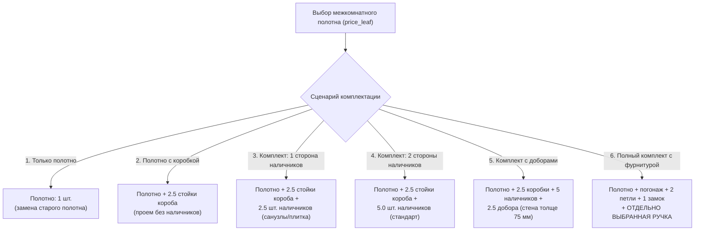
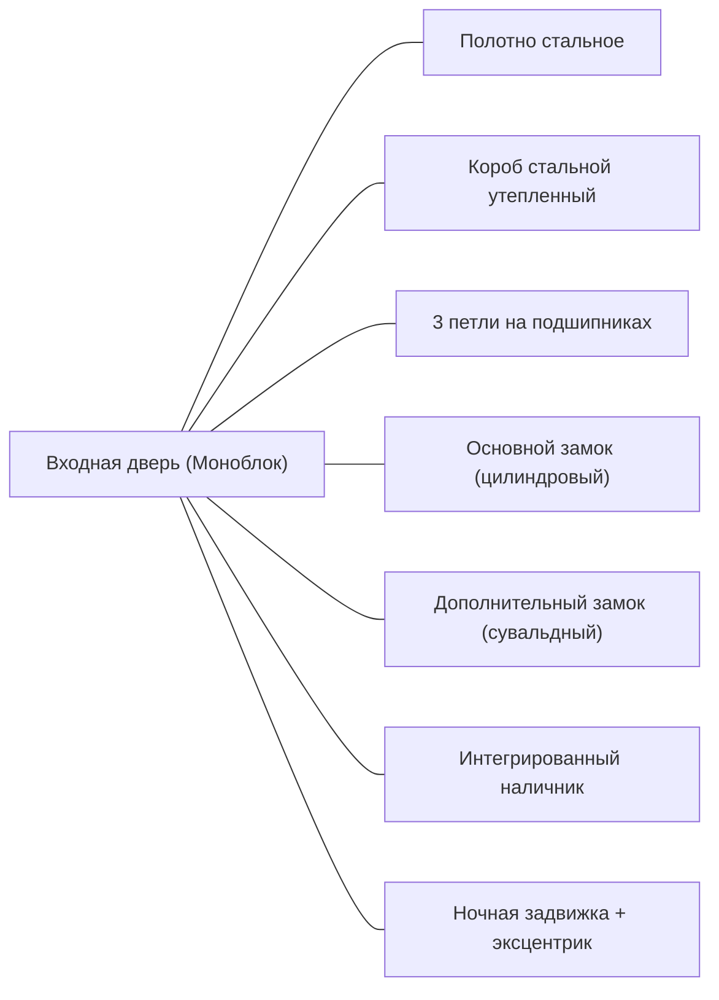
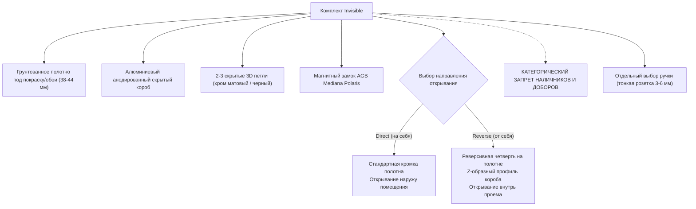

# ТЕХНИЧЕСКИЙ РЕГЛАМЕНТ ТРЕХ КОНСТРУКТИВНЫХ МОДЕЛЕЙ КОМПЛЕКТАЦИИ (V2 FINAL)

**Проект:** Федеральный интернет-магазин «Двери №1»  
**Города присутствия:** Казань, Набережные Челны  
**Версия документа:** 2.0 (Финальная ревизия с уточнением опциональности ручек и гибких сценариев комплектации)  
**Статус:** Утверждено для проектирования логики конфигуратора и корзины  

---

## 1. Сравнительная архитектурная матрица моделей

| Конструктивный узел | 1. Межкомнатные двери (`modular_kit`) | 2. Входные двери (`monolithic_block`) | 3. Скрытые двери (`invisible_kit`) |
| :--- | :--- | :--- | :--- |
| **Базовый принцип** | Модульный конструктор: раздельный расчет каждого элемента | Неделимый моноблок заводской сборки | Инженерный монокомплект скрытого монтажа |
| **Единица продажи** | Полотно отдельно ИЛИ комплект по выбору покупателя | Дверной блок целиком | Комплект заводской фрезеровки и сборки |
| **Разделение цен** | Допустимо (полотно, короб, наличники, доборы) | **СТРОГО ЗАПРЕЩЕНО** (цена полотна и короба неделима) | Неделимый комплект (полотно + короб + 3D петли + замок) |
| **Коробка** | Телескопическая МДФ/массив (расчет по 2.5 стойки) | Стальная утепленная гнуто-сварная (в блоке) | Скрытый анодированный алюминиевый профиль |
| **Наличники** | Опционально: 0 шт., 2.5 шт. (1 сторона) или 5.0 шт. (2 стороны) | Металлический наличник — единое целое с коробом | **КАТЕГОРИЧЕСКИ ЗАПРЕЩЕНЫ** (монтаж под шпаклевку) |
| **Доборы** | Опционально (при толщине стены $> 75$ мм, 2.5 планки) | Не требуются (стандартная глубина 90–148 мм) | **ЗАПРЕЩЕНЫ** (откосы штукатурятся/окрашиваются) |
| **Петли** | 2–3 шт. (накладные бабочки или врезные скрытые) | 3 шт. на подшипниках (вварены на заводе) | 2–3 шт. скрытые 3D-регулируемые (в комплекте) |
| **Замок / Защелка** | 1 шт. (магнитный или механический) с планкой | 2 замка (сувальдный + цилиндровый, врезаны) | 1 шт. магнитный замок с ответной планкой в коробе |
| **Дверная ручка** | **ОТДЕЛЬНЫЙ ВЫБОР** (НЕ входит в авто-комплект!) | Входит в комплект (раздельная ручка) | **ОТДЕЛЬНЫЙ ВЫБОР** (рекомендуются тонкие розетки) |

---

## 2. Модель 1: Межкомнатные двери (`modular_kit`)

### 2.1. Опровержение автоматического включения ручки

> [!IMPORTANT]
> **Архитектурная директива:**  
> Ручка **НЕ включается автоматически** в стандартный комплект межкомнатной двери!  
> 
> **Причины:**
> 1. **Дизайн и стиль:** Ручка — главный элемент интерьерного декорирования. Покупатель выбирает дизайн (строгий квадрат, плавный овал, лофт, классика) и цвет (матовый хром, матовый черный, брашированное золото, античная бронза) индивидуально под смесители и светильники.
> 2. **Широкий ценовой диапазон:** Стоимость ручки варьируется от 890 ₽ (FUARO/PUNTO) до 8 500+ ₽ (итальянская коллекция Morelli Luxury). Включение случайной ручки в базовую стоимость исказит привлекательность стартовой цены на витрине.
> 3. **Повторное использование:** До 15% покупателей меняют двери, оставляя свою существующую фурнитуру, либо покупают полотна для строительных объектов со своими ручками.

### 2.2. Шесть поддерживаемых конфигураций заказа

Модель данных и интерфейс конфигуратора поддерживают 6 гибких сценариев покупки:



#### Детализация сценариев:

1. **Конфигурация 1: «Только полотно» (`leaf_only`)**
   - Состав: 1 дверное полотно выбранного размера и цвета.
   - Применение: Замена поврежденного полотна в существующую коробку, раздвижные двери-купе на верхнем подвесе.
   - Формула: $P = P_{leaf}$

2. **Конфигурация 2: «Полотно с коробкой» (`leaf_with_frame`)**
   - Состав: 1 полотно + 2.5 стойки телескопической коробки.
   - Применение: Проемы, оформляемые плиткой, стеновыми панелями или скрытым финишным профилем без выступающих наличников.
   - Формула: $P = P_{leaf} + 2.5 \times P_{frame\_pc}$

3. **Конфигурация 3: «Комплект с наличниками на 1 сторону» (`kit_casing_1side`)**
   - Состав: 1 полотно + 2.5 стойки коробки + 2.5 стойки наличника.
   - Применение: Двери в ванную комнату и санузел, где изнутри проем отделан кафельной плиткой под срез короба, а наличник устанавливается только снаружи со стороны коридора.
   - Формула: $P = P_{leaf} + 2.5 \times P_{frame\_pc} + 2.5 \times P_{casing\_pc}$

4. **Конфигурация 4: «Комплект с наличниками на 2 стороны» (`kit_casing_2sides`)**
   - Состав: 1 полотно + 2.5 стойки коробки + 5.0 стоек наличника.
   - Применение: Классический межкомнатный проем в перегородке стандартной толщины (до 75 мм).
   - Формула: $P = P_{leaf} + 2.5 \times P_{frame\_pc} + 5.0 \times P_{casing\_pc}$

5. **Конфигурация 5: «Комплект с доборами» (`kit_with_extensions`)**
   - Состав: 1 полотно + 2.5 стойки коробки + 5.0 стоек наличника + 2.5 планки доборного элемента.
   - Определение ширины добора по толщине стены $T_{wall}$:
     * $T_{wall} \le 75$ мм: добор **не требуется** (телескопический наличник перекрывает до 75 мм за счет вылета шипа).
     * $76 \le T_{wall} \le 120$ мм: добор шириной **100 мм** (2.5 планки).
     * $121 \le T_{wall} \le 170$ мм: добор шириной **150 мм** (2.5 планки).
     * $171 \le T_{wall} \le 220$ мм: добор шириной **200 мм** (2.5 планки).
     * $T_{wall} > 220$ мм: стыковка двух доборов через Н-образный профиль.
   - Формула: $P = P_{leaf} + 2.5 \times P_{frame\_pc} + 5.0 \times P_{casing\_pc} + 2.5 \times P_{ext\_pc}$

6. **Конфигурация 6: «Полный комплект с выбранной фурнитурой» (`full_kit_custom_hardware`)**
   - Состав: Полотно + выбранный погонаж (коробка, наличники, доборы) + 2 петли (бабочки или врезные) + 1 врезной замок с ответной планкой + **отдельно выбранная покупателем ручка** (+ опционально сантехническая завертка WC).
   - Формула:
     $$P_{total} = P_{leaf} + (2.5 \times P_{frame}) + (K_{casing} \times P_{casing}) + (K_{ext} \times P_{ext}) + (2 \times P_{hinge}) + P_{lock} + [P_{handle\_custom}]$$

### 2.3. Правила округления и единицы измерения погонажа

- **Кратность стоек 0.5:**  
  На один дверной блок расходуется ровно 2 вертикальные стойки высотой 2070 мм и половина стойки (1035 мм) на горизонтальную перекладину проема. В заказе фиксируется `quantity = 2.5` со штучной ценой за 1 стойку.
- **Двустворчатые двери (распашные):**  
  При ширине проема от 1200 мм (два полотна по 600/700/800 мм) расход погонажа автоматически пересчитывается:
  * Коробка: 3.0 стойки (2 вертикали + 1 целая горизонталь 1400–1800 мм);
  * Наличники: 6.0 стоек (на 2 стороны);
  * Притворная планка (нащельник): 1.0 шт.

---

## 3. Модель 2: Входные двери (`monolithic_block`)

### 3.1. Архитектурные ограничения и неделимость цены



> [!CAUTION]
> **Защита от двойного учета:**
> Входная металлическая дверь изготавливается и отгружается заводом как **единый неделимый сборочный блок**.
> 
> 1. **Запрет разделения цен:** В базе данных `products.base_leaf_price` для входных дверей равен `NULL`, а цена зафиксирована в `base_kit_price`.
> 2. **Запрет добавления погонажа:** Попытка добавить телескопическую коробку, деревянные наличники или доборы из межкомнатного раздела к входной двери блокируется валидатором корзины на уровне схемы БД (`chk_order_item_qty`) и API.
> 3. **Запрет дублирования петель и замков:** Петли приварены к раме на заводе, замки 4-го класса взломостойкости (Гардиан, Border, Kale) уже смонтированы внутри полотна. В конфигураторе покупателю запрещено повторно продавать стандартные петли или замки.

### 3.2. Допустимые конструктивные опции входной двери

1. **Габаритные размеры блока (по внешней раме короба):**
   - $860 \times 2050$ мм (для стандартного строительного проема $900 \times 2080$ мм).
   - $960 \times 2050$ мм (для расширенного строительного проема $1000 \times 2080$ мм).
2. **Сторона открывания (наружу):**
   - **Левое открывание (L):** петли слева при взгляде снаружи, ручка справа, открывание левой рукой на себя.
   - **Правое открывание (R):** петли справа при взгляде снаружи, ручка слева, открывание правой рукой на себя.
3. **Конструктивные модификации:**
   - *Для квартиры:* 2–3 контура резинового уплотнения, базальтовая плита высокой плотности, толщина полотна 70–115 мм.
   - *Для частного дома (улица):* обязательный **терморазрыв** (полиамидный термомост в полотне и коробе, исключающий промерзание и конденсат), 3 контура уплотнения.
4. **Опциональный апгрейд (не нарушающий монолитность):**
   - Замена механического цилиндра на биометрический умный смарт-замок (отпечаток пальца, пароль, карта, смартфон).
   - Выбор сервисных опций: профессиональный замер, доставка по Казани/Челнам, демонтаж старой деревянной/металлической двери, монтаж на анкерные болты и сварку с запениванием противопожарной пеной.

---

## 4. Модель 3: Скрытые двери (`invisible_kit`)

### 4.1. Специфика скрытого монтажа

Двери скрытого монтажа (серия *Invisible*) монтируются на этапе черновых строительных работ до укладки финишного напольного покрытия и финишной штукатурки стен.



### 4.2. Архитектурные правила для Invisible

1. **Строгий запрет на наличники:**  
   Алюминиевый короб скрытой двери зашпаклевывается заподлицо со стеной из гипсокартона или кирпича. На коробке отсутствует телескопический паз. Добавление любых наличников в заказ скрытой двери физически невозможно и жестко блокируется системой.
2. **Геометрия Direct vs Reverse:**
   - **Direct (прямое открывание, на себя):** полотно находится в одной плоскости со стеной снаружи комнаты и распахивается наружу. Полотно имеет ровный прямой торец.
   - **Reverse (обратное открывание, от себя):** полотно находится в одной плоскости со стеной снаружи, но открывается внутрь комнаты. Полотно изготавливается со специальной заводской ступенчатой четвертью (фальцем), а скрытый короб имеет Z-образный профиль.
   - *Важно:* Изменить открывание с Direct на Reverse на объекте монтажа невозможно — это две разные заводские позиции полотна и короба. Выбор типа открывания обязателен в конфигураторе.
3. **Заводская врезка фурнитуры:**
   - В скрытом коробе и полотне на станках ЧПУ на заводе выполнены посадочные карманы под 3D-петли и магнитный замок **AGB Mediana Polaris (196×18 мм)**.
   - Использование другой фурнитуры без заводской врезки приведет к порче алюминиевого короба.
4. **Выбор ручки:**
   - Ручка выбирается покупателем отдельно.
   - Для сохранения концепции минимализма система рекомендует ручки на супертонких круглых или квадратных розетках толщиной 3–6 мм (серии Morelli DIY Slim, Armadillo Slim).

---

## 5. Валидационные правила конфигуратора (Бизнес-логика)

```typescript
// Псевдокод валидации параметров комплектации в backend-сервисе
export function validateCartConfiguration(item: CartItemInput): ValidationResult {
  const { product, configurationType, casingsCount, extensionsCount, hardwareItems } = item;

  // 1. Проверка моноблока входной двери
  if (product.pricingType === 'monolithic_block') {
    if (casingsCount > 0 || extensionsCount > 0) {
      return { valid: false, error: 'К входной двери нельзя добавлять погонаж (коробка и наличники уже входят в блок).' };
    }
    const hasStandaloneHinges = hardwareItems.some(h => h.type === 'hinge');
    if (hasStandaloneHinges) {
      return { valid: false, error: 'Петли входной двери приварены на заводе и не могут выбираться отдельно.' };
    }
  }

  // 2. Проверка скрытой двери Invisible
  if (product.pricingType === 'invisible_kit') {
    if (casingsCount > 0) {
      return { valid: false, error: 'Скрытые двери монтируются вровень со стеной. Наличники строго запрещены.' };
    }
    if (extensionsCount > 0) {
      return { valid: false, error: 'К скрытому алюминиевому коробу нельзя монтировать стандартные доборы.' };
    }
    if (!item.openingDirection || !['direct', 'reverse'].includes(item.openingDirection)) {
      return { valid: false, error: 'Для скрытой двери обязательно указание геометрии открывания: Direct или Reverse.' };
    }
  }

  // 3. Проверка ручки для межкомнатных дверей
  if (product.pricingType === 'modular_kit') {
    // Ручка является опциональной сущностью
    const handleCount = hardwareItems.filter(h => h.type === 'handle').length;
    if (handleCount > 1) {
      return { valid: false, error: 'На одно дверное полотно не может быть назначено более одной ручки.' };
    }
  }

  return { valid: true };
}
```
