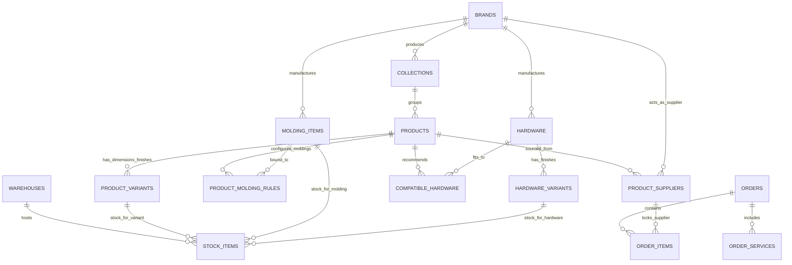

# ПОЛНАЯ АРХИТЕКТУРНАЯ СХЕМА БАЗЫ ДАННЫХ И DDL ДЛЯ КАТАЛОГА «ДВЕРИ №1» (V2 FINAL)

**Проект:** Федеральный интернет-магазин «Двери №1»  
**Города присутствия:** Казань (Сибирский тракт, 59б), Набережные Челны (Казанский проспект, 232)  
**Версия документа:** 2.0 (Финальная архитектурная ревизия перед разработкой)  
**Статус:** Утвержденная проектная модель данных (БЕЗ запуска боевых миграций и изменения сайта на данном этапе)  

---

## 1. Концептуальная и логическая модель данных

Архитектура базы данных каталога «Двери №1» спроектирована с учетом специфики дверной индустрии:
1. **Разделение витрины и источников поставки:** Витринная карточка (`products`) является мастер-моделью для клиента. Источники поставки, поставщики, дилеры и страницы печатных каталогов нормализованы в `product_suppliers` (связь $1 : N$).
2. **Физическая номенклатура погонажа:** Коробки, наличники и доборы вынесены из текстовых полей в самостоятельную номенклатурную таблицу `molding_items` со своими артикулами, физическими габаритами, отделками и штучной ценой.
3. **Разделение фурнитуры на индивидуальные SKU:** Сущность `hardware` декомпозирована на базовую модель и дочернюю таблицу отделок `hardware_variants`, гарантируя уникальный артикул для каждого цвета ручки/петли/замка.
4. **Опциональность ручки:** Ручка **НЕ включается принудительно** в базовую комплектацию межкомнатного комплекта (`modular_kit`), а выбирается покупателем отдельно или рассчитывается опционально.
5. **Мультискладской раздельный учет:** Физические склады в Казани и Набережных Челнах изолированы в таблице `warehouses`. Остатки разделены на физическое наличие (`stock_qty`) и резервы (`reserved_qty`), а любое подтверждение остатков требует ручной проверки менеджером (`manager_confirmation_required`).
6. **Защита финансовых транзакций (Price Snapshotting):** Заказы клиентов (`orders`, `order_items`) замораживают цены, себестоимость, выбранного поставщика и текстовые спецификации на момент оформления.

### Диаграмма связей сущностей (Entity-Relationship Diagram)



---

## 2. Полный чистовой PostgreSQL DDL (Data Definition Language)

```sql
-- ============================================================================
-- БАЗА ДАННЫХ ИНТЕРНЕТ-МАГАЗИНА «ДВЕРИ №1»
-- Стандарт: PostgreSQL 14+ / 15+ / 16+
-- ============================================================================

-- Включение расширений для генерации UUID и регистронезависимого поиска
CREATE EXTENSION IF NOT EXISTS "uuid-ossp";
CREATE EXTENSION IF NOT EXISTS "citext";

-- ============================================================================
-- 1. БРЕНДЫ И ПРОИЗВОДИТЕЛИ (BRANDS)
-- ============================================================================
CREATE TABLE brands (
    id VARCHAR(64) PRIMARY KEY,
    name VARCHAR(255) NOT NULL,
    country VARCHAR(100) NOT NULL,
    description TEXT,
    logo_url VARCHAR(500),
    is_active BOOLEAN NOT NULL DEFAULT TRUE,
    created_at TIMESTAMP WITH TIME ZONE NOT NULL DEFAULT CURRENT_TIMESTAMP,
    updated_at TIMESTAMP WITH TIME ZONE NOT NULL DEFAULT CURRENT_TIMESTAMP
);

COMMENT ON TABLE brands IS 'Фабрики, заводы-изготовители и торговые марки дверной продукции и фурнитуры';
COMMENT ON COLUMN brands.id IS 'Уникальный строковый слаг производителя (например: dvereki, chameleondoors, ferroni)';

-- ============================================================================
-- 2. КОЛЛЕКЦИИ (COLLECTIONS)
-- ============================================================================
CREATE TABLE collections (
    id VARCHAR(64) PRIMARY KEY,
    brand_id VARCHAR(64) NOT NULL REFERENCES brands(id) ON DELETE RESTRICT,
    name VARCHAR(255) NOT NULL,
    category VARCHAR(100) NOT NULL,
    description TEXT,
    is_active BOOLEAN NOT NULL DEFAULT TRUE,
    created_at TIMESTAMP WITH TIME ZONE NOT NULL DEFAULT CURRENT_TIMESTAMP,
    updated_at TIMESTAMP WITH TIME ZONE NOT NULL DEFAULT CURRENT_TIMESTAMP,
    CONSTRAINT chk_collection_category CHECK (
        category IN ('Входные двери', 'Межкомнатные двери', 'Скрытые двери', 'Фурнитура', 'Специальные двери')
    )
);

COMMENT ON TABLE collections IS 'Серии и модельные ряды внутри бренда';

-- ============================================================================
-- 3. МАСТЕР-КАРТОЧКИ ТОВАРОВ (PRODUCTS)
-- ============================================================================
CREATE TABLE products (
    id VARCHAR(64) PRIMARY KEY,
    brand_id VARCHAR(64) NOT NULL REFERENCES brands(id) ON DELETE RESTRICT,
    collection_id VARCHAR(64) NOT NULL REFERENCES collections(id) ON DELETE RESTRICT,
    model_name VARCHAR(255) NOT NULL,
    category VARCHAR(100) NOT NULL,
    door_type VARCHAR(100),
    construction VARCHAR(255),
    coating_type VARCHAR(100),
    style VARCHAR(100),
    has_glass BOOLEAN NOT NULL DEFAULT FALSE,
    glass_type VARCHAR(255),
    
    -- Конструктивно-ценовая модель:
    -- 'monolithic_block' - неделимый блок входной двери
    -- 'modular_kit'      - модульный расчет межкомнатной двери (полотно + короб + наличники + доборы)
    -- 'invisible_kit'    - скрытая дверь (полотно под грунт + скрытый алюминиевый короб + замок + 3D петли)
    pricing_type VARCHAR(32) NOT NULL,
    
    base_leaf_price NUMERIC(10,2) NULL,
    base_kit_price NUMERIC(10,2) NULL,
    price_status VARCHAR(32) NOT NULL DEFAULT 'quote',
    is_active BOOLEAN NOT NULL DEFAULT TRUE,
    view_count INT NOT NULL DEFAULT 0,
    created_at TIMESTAMP WITH TIME ZONE NOT NULL DEFAULT CURRENT_TIMESTAMP,
    updated_at TIMESTAMP WITH TIME ZONE NOT NULL DEFAULT CURRENT_TIMESTAMP,
    
    CONSTRAINT chk_product_pricing_type CHECK (
        pricing_type IN ('monolithic_block', 'modular_kit', 'invisible_kit')
    ),
    CONSTRAINT chk_product_price_status CHECK (
        price_status IN ('fixed', 'from', 'quote')
    )
);

COMMENT ON TABLE products IS 'Мастер-карточки моделей дверей для клиентской витрины';
COMMENT ON COLUMN products.pricing_type IS 'Тип комплектации и алгоритма калькуляции корзины';

-- ============================================================================
-- 4. ИСТОЧНИКИ ПОСТАВКИ И ПЕРВИЧНЫЕ КАТАЛОГИ (PRODUCT_SUPPLIERS)
-- Решает проблему 24 кластеров дублей и работы с множеством поставщиков
-- ============================================================================
CREATE TABLE product_suppliers (
    id SERIAL PRIMARY KEY,
    product_id VARCHAR(64) NOT NULL REFERENCES products(id) ON DELETE CASCADE,
    supplier_brand_id VARCHAR(64) NOT NULL REFERENCES brands(id) ON DELETE RESTRICT,
    catalog_name VARCHAR(255) NOT NULL,
    catalog_page INT NOT NULL,
    supplier_article VARCHAR(100),
    is_primary BOOLEAN NOT NULL DEFAULT FALSE,
    purchase_price NUMERIC(10,2) NULL,
    
    -- Статус поставщика для данной модели:
    -- 'active'      - регулярная поставка
    -- 'on_order'    - под заказ с завода (срок плавающий, подтверждается менеджером)
    -- 'discontinued'- снято с производства данным поставщиком (не удаляет товар из других источников!)
    supplier_status VARCHAR(32) NOT NULL DEFAULT 'on_order',
    lead_time_days INT NULL, -- NULL означает «уточняется менеджером», фиктивные сроки запрещены
    notes TEXT,
    created_at TIMESTAMP WITH TIME ZONE NOT NULL DEFAULT CURRENT_TIMESTAMP,
    updated_at TIMESTAMP WITH TIME ZONE NOT NULL DEFAULT CURRENT_TIMESTAMP,
    
    CONSTRAINT chk_supplier_status CHECK (
        supplier_status IN ('active', 'on_order', 'discontinued')
    )
);

COMMENT ON TABLE product_suppliers IS 'Связь мастер-товара с фабриками, каталогами, оптовыми ценами и артикулами';

-- ============================================================================
-- 5. ВАРИАНТЫ ИСПОЛНЕНИЯ МОДЕЛЕЙ ДВЕРЕЙ (PRODUCT_VARIANTS)
-- ============================================================================
CREATE TABLE product_variants (
    id VARCHAR(64) PRIMARY KEY,
    product_id VARCHAR(64) NOT NULL REFERENCES products(id) ON DELETE CASCADE,
    sku VARCHAR(100) UNIQUE,
    height_mm INT NOT NULL,
    width_mm INT NOT NULL,
    thickness_mm INT NOT NULL DEFAULT 38,
    outside_color VARCHAR(255) NOT NULL,
    inside_color VARCHAR(255),
    is_composite_color BOOLEAN NOT NULL DEFAULT FALSE,
    
    -- Сторона открывания:
    -- 'universal' - для межкомнатных симметричных полотен без заводской врезки
    -- 'left', 'right' - для входных дверей и полотен с фабричной врезкой
    -- 'direct', 'reverse' - для скрытых дверей Invisible
    opening_direction VARCHAR(32) NOT NULL DEFAULT 'universal',
    
    image_url VARCHAR(500),
    price_delta NUMERIC(10,2) NOT NULL DEFAULT 0.00,
    is_available BOOLEAN NOT NULL DEFAULT TRUE,
    created_at TIMESTAMP WITH TIME ZONE NOT NULL DEFAULT CURRENT_TIMESTAMP,
    updated_at TIMESTAMP WITH TIME ZONE NOT NULL DEFAULT CURRENT_TIMESTAMP,
    
    CONSTRAINT chk_variant_opening_dir CHECK (
        opening_direction IN ('universal', 'left', 'right', 'direct', 'reverse')
    ),
    CONSTRAINT chk_variant_dimensions CHECK (
        height_mm BETWEEN 1500 AND 3000 AND width_mm BETWEEN 300 AND 1400 AND thickness_mm BETWEEN 30 AND 160
    )
);

COMMENT ON TABLE product_variants IS 'Торговые предложения (SKU) по габаритам, декорам и геометрии открывания';

-- ============================================================================
-- 6. НОМЕНКЛАТУРА ПОГОНАЖНЫХ ИЗДЕЛИЙ (MOLDING_ITEMS)
-- Самостоятельный складской штучный товар
-- ============================================================================
CREATE TABLE molding_items (
    id VARCHAR(64) PRIMARY KEY,
    brand_id VARCHAR(64) NOT NULL REFERENCES brands(id) ON DELETE RESTRICT,
    article VARCHAR(100),
    
    -- Тип погонажного элемента:
    -- 'frame'          - коробка телескопическая
    -- 'casing'         - наличник телескопический
    -- 'extension'      - доборная планка телескопическая
    -- 'plinth'         - плинтус напольный в цвет двери
    -- 'invisible_frame'- скрытый алюминиевый короб
    -- 'false_beam'     - притворная планка для двустворчатых дверей
    molding_type VARCHAR(64) NOT NULL,
    
    name VARCHAR(255) NOT NULL,
    coating_type VARCHAR(100),
    color VARCHAR(255) NOT NULL,
    
    length_mm INT NOT NULL DEFAULT 2070,
    width_mm INT NOT NULL,              -- 70, 75, 80 для наличников; 100, 150, 200 для доборов
    thickness_mm INT NOT NULL,          -- 10, 16, 32 мм
    unit VARCHAR(16) NOT NULL DEFAULT 'pc', -- 'pc' (штука / стойка), 'set' (комплект)
    
    unit_price NUMERIC(10,2) NULL,
    price_status VARCHAR(32) NOT NULL DEFAULT 'quote',
    is_active BOOLEAN NOT NULL DEFAULT TRUE,
    created_at TIMESTAMP WITH TIME ZONE NOT NULL DEFAULT CURRENT_TIMESTAMP,
    updated_at TIMESTAMP WITH TIME ZONE NOT NULL DEFAULT CURRENT_TIMESTAMP,
    
    CONSTRAINT chk_molding_type CHECK (
        molding_type IN ('frame', 'casing', 'extension', 'plinth', 'invisible_frame', 'false_beam')
    ),
    CONSTRAINT chk_molding_unit CHECK (
        unit IN ('pc', 'set', 'meter')
    )
);

COMMENT ON TABLE molding_items IS 'Физическая номенклатура коробок, наличников и доборов с розничными ценами за стойку';

-- ============================================================================
-- 7. ПРАВИЛА И НОРМЫ КОМПЛЕКТАЦИИ ПОГОНАЖЕМ (PRODUCT_MOLDING_RULES)
-- ============================================================================
CREATE TABLE product_molding_rules (
    id SERIAL PRIMARY KEY,
    product_id VARCHAR(64) NOT NULL REFERENCES products(id) ON DELETE CASCADE,
    molding_item_id VARCHAR(64) NOT NULL REFERENCES molding_items(id) ON DELETE RESTRICT,
    
    -- Роль элемента:
    -- 'default_frame'         - базовая коробка для модели
    -- 'default_casing'        - базовый плоский наличник
    -- 'decorative_casing'     - фигурный/каннелированный наличник
    -- 'compatible_extension'  - совместимый добор
    role VARCHAR(32) NOT NULL,
    
    -- Норма расхода на 1 полотно (2.5 стойки короба, 2.5 наличника на сторону, 5.0 на 2 стороны)
    default_quantity NUMERIC(4,2) NOT NULL,
    is_required BOOLEAN NOT NULL DEFAULT FALSE,
    created_at TIMESTAMP WITH TIME ZONE NOT NULL DEFAULT CURRENT_TIMESTAMP,
    
    CONSTRAINT chk_molding_role CHECK (
        role IN ('default_frame', 'default_casing', 'decorative_casing', 'compatible_extension', 'invisible_frame')
    ),
    CONSTRAINT uq_product_molding_role UNIQUE (product_id, molding_item_id, role)
);

COMMENT ON TABLE product_molding_rules IS 'Нормативы расхода погонажа на дверное полотно';

-- ============================================================================
-- 8. КАТАЛОГ ФУРНИТУРЫ (HARDWARE)
-- ============================================================================
CREATE TABLE hardware (
    id VARCHAR(64) PRIMARY KEY,
    brand_id VARCHAR(64) NOT NULL REFERENCES brands(id) ON DELETE RESTRICT,
    collection_name VARCHAR(255),
    model_name VARCHAR(255) NOT NULL,
    
    -- Тип фурнитуры:
    -- 'handle_rosette' - ручка на круглой/квадратной розетке
    -- 'handle_plate'   - ручка на планке (для входных дверей)
    -- 'hinge_concealed'- скрытая 3D-петля
    -- 'hinge_butt'     - универсальная или бабочка
    -- 'lock_magnetic'  - магнитный замок
    -- 'lock_cylinder'  - замок под цилиндр / сувальдный
    -- 'closer'         - доводчик
    -- 'stopper'        - ограничитель хода двери (магнитный / напольный)
    -- 'wc_lock'        - завертка сантехническая
    -- 'escutcheon'     - накладка под ключ
    hardware_type VARCHAR(64) NOT NULL,
    material VARCHAR(100),
    rosette_thickness_mm INT DEFAULT 6, -- 3-6 мм для скрытых/минималистичных дверей
    door_thickness_min INT DEFAULT 35,
    door_thickness_max INT DEFAULT 55,
    is_active BOOLEAN NOT NULL DEFAULT TRUE,
    created_at TIMESTAMP WITH TIME ZONE NOT NULL DEFAULT CURRENT_TIMESTAMP,
    updated_at TIMESTAMP WITH TIME ZONE NOT NULL DEFAULT CURRENT_TIMESTAMP,
    
    CONSTRAINT chk_hardware_type CHECK (
        hardware_type IN (
            'handle_rosette', 'handle_plate', 'hinge_concealed', 'hinge_butt',
            'lock_magnetic', 'lock_cylinder', 'closer', 'stopper', 'wc_lock', 'escutcheon'
        )
    )
);

COMMENT ON TABLE hardware IS 'Мастер-модели фурнитуры (ручки, замки, петли, механизмы)';

-- ============================================================================
-- 9. ЦВЕТОВЫЕ ВАРИАНТЫ ФУРНИТУРЫ (HARDWARE_VARIANTS)
-- Разрешает проблему отсутствия индивидуальных SKU на цвета ручек
-- ============================================================================
CREATE TABLE hardware_variants (
    id VARCHAR(64) PRIMARY KEY,
    hardware_id VARCHAR(64) NOT NULL REFERENCES hardware(id) ON DELETE CASCADE,
    article VARCHAR(100) UNIQUE NOT NULL,
    color_finish VARCHAR(255) NOT NULL,
    color_code VARCHAR(32), -- 'SN', 'CP', 'BL', 'GL', 'AB'
    image_url VARCHAR(500),
    price NUMERIC(10,2) NULL,
    price_status VARCHAR(32) NOT NULL DEFAULT 'quote',
    is_available BOOLEAN NOT NULL DEFAULT TRUE,
    created_at TIMESTAMP WITH TIME ZONE NOT NULL DEFAULT CURRENT_TIMESTAMP,
    updated_at TIMESTAMP WITH TIME ZONE NOT NULL DEFAULT CURRENT_TIMESTAMP
);

COMMENT ON TABLE hardware_variants IS 'Конкретные модификации фурнитуры в привязке к цвету и фабричному артикулу';

-- ============================================================================
-- 10. ПРАВИЛА СОВМЕСТИМОСТИ ФУРНИТУРЫ С МОДЕЛЯМИ ДВЕРЕЙ (COMPATIBLE_HARDWARE)
-- ============================================================================
CREATE TABLE compatible_hardware (
    id SERIAL PRIMARY KEY,
    product_id VARCHAR(64) NOT NULL REFERENCES products(id) ON DELETE CASCADE,
    hardware_id VARCHAR(64) NOT NULL REFERENCES hardware(id) ON DELETE CASCADE,
    
    -- Статус верификации совместимости:
    -- 'verified_factory' - подтверждено чертежами фабрики и посадочными пазами
    -- 'unverified'       - не подтверждено документально (требуется проверка замерщиком)
    -- 'prohibited'       - физически несовместимо (например, наличник на скрытую дверь)
    verification_status VARCHAR(32) NOT NULL DEFAULT 'unverified',
    
    -- Роль фурнитуры для данной модели:
    -- 'default_included' - входит в заводскую сборку (моноблок входной, замок в Invisible)
    -- 'recommended_addon'- рекомендованный отдельный выбор (ручка Morelli)
    -- 'optional'         - дополнительная опция (доводчик, стоппер)
    hardware_role VARCHAR(32) NOT NULL DEFAULT 'recommended_addon',
    
    quantity_required INT NOT NULL DEFAULT 1,
    compatibility_note TEXT,
    created_at TIMESTAMP WITH TIME ZONE NOT NULL DEFAULT CURRENT_TIMESTAMP,
    
    CONSTRAINT chk_hardware_verif_status CHECK (
        verification_status IN ('verified_factory', 'unverified', 'prohibited')
    ),
    CONSTRAINT chk_hardware_role CHECK (
        hardware_role IN ('default_included', 'recommended_addon', 'optional')
    ),
    CONSTRAINT uq_product_hardware UNIQUE (product_id, hardware_id)
);

COMMENT ON TABLE compatible_hardware IS 'Матрица совместимости фурнитуры с дверными полотнами';

-- ============================================================================
-- 11. СКЛАДЫ (WAREHOUSES) - КАЗАНЬ И НАБЕРЕЖНЫЕ ЧЕЛНЫ
-- ============================================================================
CREATE TABLE warehouses (
    id VARCHAR(32) PRIMARY KEY,
    city VARCHAR(100) NOT NULL,
    title VARCHAR(255) NOT NULL,
    address VARCHAR(255) NOT NULL,
    phone VARCHAR(50),
    is_active BOOLEAN NOT NULL DEFAULT TRUE,
    created_at TIMESTAMP WITH TIME ZONE NOT NULL DEFAULT CURRENT_TIMESTAMP
);

COMMENT ON TABLE warehouses IS 'Физические склады и логистические хабы';

-- ============================================================================
-- 12. ОСТАТКИ, РЕЗЕРВЫ И СТАТУСЫ НАЛИЧИЯ (STOCK_ITEMS)
-- Раздельный учет физического наличия и резерва, обязательное подтверждение
-- ============================================================================
CREATE TABLE stock_items (
    id SERIAL PRIMARY KEY,
    warehouse_id VARCHAR(32) NOT NULL REFERENCES warehouses(id) ON DELETE RESTRICT,
    item_type VARCHAR(32) NOT NULL, -- 'door_variant', 'molding', 'hardware_variant'
    item_id VARCHAR(64) NOT NULL,
    
    -- Количественный учет
    stock_qty INT NOT NULL DEFAULT 0,
    reserved_qty INT NOT NULL DEFAULT 0,
    available_qty INT GENERATED ALWAYS AS (stock_qty - reserved_qty) STORED,
    
    -- Статус наличия:
    -- 'in_stock'                  - физически на складе в достаточном количестве
    -- 'reserved'                  - весь остаток в брони под заказы
    -- 'on_order_factory'          - под заказ с завода (срок плавающий)
    -- 'out_of_stock'              - отсутствует на складе
    stock_status VARCHAR(64) NOT NULL DEFAULT 'on_order_factory',
    
    -- Флаг обязательного подтверждения менеджером (блокирует автоматическое автосписание!)
    manager_confirmation_required BOOLEAN NOT NULL DEFAULT TRUE,
    
    last_inventory_date TIMESTAMP WITH TIME ZONE NULL,
    updated_at TIMESTAMP WITH TIME ZONE NOT NULL DEFAULT CURRENT_TIMESTAMP,
    
    CONSTRAINT chk_stock_item_type CHECK (
        item_type IN ('door_variant', 'molding', 'hardware_variant')
    ),
    CONSTRAINT chk_stock_quantities CHECK (
        stock_qty >= 0 AND reserved_qty >= 0 AND reserved_qty <= stock_qty
    ),
    CONSTRAINT chk_stock_status_enum CHECK (
        stock_status IN ('in_stock', 'reserved', 'on_order_factory', 'out_of_stock')
    ),
    CONSTRAINT uq_warehouse_item UNIQUE (warehouse_id, item_type, item_id)
);

COMMENT ON TABLE stock_items IS 'Складские остатки с разделением физического наличия и резервов';

-- ============================================================================
-- 13. ЗАКАЗЫ ПОКУПАТЕЛЕЙ (ORDERS)
-- ============================================================================
CREATE TABLE orders (
    id SERIAL PRIMARY KEY,
    order_number VARCHAR(32) UNIQUE NOT NULL,
    customer_name VARCHAR(255) NOT NULL,
    customer_phone VARCHAR(50) NOT NULL,
    customer_email VARCHAR(255),
    customer_city VARCHAR(64) NOT NULL, -- 'Казань', 'Набережные Челны'
    delivery_address TEXT,
    
    warehouse_assigned_id VARCHAR(32) REFERENCES warehouses(id),
    
    total_amount NUMERIC(10,2) NOT NULL DEFAULT 0.00,
    services_amount NUMERIC(10,2) NOT NULL DEFAULT 0.00,
    grand_total NUMERIC(10,2) NOT NULL DEFAULT 0.00,
    
    -- Жизненный цикл заказа:
    -- 'new_pending_manager'       - оформлен на сайте, ожидает звонка менеджера
    -- 'measurement_scheduled'     - назначен выезд замерщика
    -- 'measured_confirmed'        - замер выполнен, спецификация утверждена клиентом
    -- 'stock_reserved'            - остаток вручную подтвержден и поставлен в резерв
    -- 'factory_ordered'           - отправлен заказ на завод
    -- 'ready_for_shipping'        - собран на складе Казани/Челнов
    -- 'completed'                 - установлен и подписан акт
    -- 'cancelled'                 - отменен
    order_status VARCHAR(64) NOT NULL DEFAULT 'new_pending_manager',
    
    manager_comment TEXT,
    created_at TIMESTAMP WITH TIME ZONE NOT NULL DEFAULT CURRENT_TIMESTAMP,
    updated_at TIMESTAMP WITH TIME ZONE NOT NULL DEFAULT CURRENT_TIMESTAMP,
    
    CONSTRAINT chk_order_status CHECK (
        order_status IN (
            'new_pending_manager', 'measurement_scheduled', 'measured_confirmed',
            'stock_reserved', 'factory_ordered', 'ready_for_shipping', 'completed', 'cancelled'
        )
    )
);

COMMENT ON TABLE orders IS 'Заказы клиентов с привязкой к городу и статусом подтверждения менеджером';

-- ============================================================================
-- 14. СТРОКИ ЗАКАЗА СО СНИМКАМИ ЦЕН И ПОСТАВЩИКА (ORDER_ITEMS)
-- Гарантия финансовой безопасности: заморозка цен и источников поставки
-- ============================================================================
CREATE TABLE order_items (
    id SERIAL PRIMARY KEY,
    order_id INT NOT NULL REFERENCES orders(id) ON DELETE CASCADE,
    
    item_type VARCHAR(32) NOT NULL, -- 'door_leaf', 'door_frame', 'casing', 'extension', 'hardware_handle', 'hardware_hinge', 'hardware_lock', 'monolithic_door'
    item_id VARCHAR(64) NOT NULL,
    
    -- Заморозка поставщика на момент заказа (защита от изменения фабрик и условий)
    product_supplier_id INT REFERENCES product_suppliers(id) ON DELETE SET NULL,
    supplier_name_snapshot VARCHAR(255),
    supplier_article_snapshot VARCHAR(100),
    
    -- Заморозка витринных параметров изделия
    name_snapshot VARCHAR(255) NOT NULL,
    variant_snapshot VARCHAR(255),
    
    -- Заморозка финансовых показателей
    unit_price_snapshot NUMERIC(10,2) NOT NULL,
    purchase_price_snapshot NUMERIC(10,2) NULL, -- оптовая цена для контроля маржи
    quantity NUMERIC(6,2) NOT NULL,             -- дробное для погонажа (например 2.5 стойки)
    unit VARCHAR(16) NOT NULL DEFAULT 'pc',
    subtotal NUMERIC(10,2) NOT NULL,
    
    created_at TIMESTAMP WITH TIME ZONE NOT NULL DEFAULT CURRENT_TIMESTAMP,
    
    CONSTRAINT chk_order_item_qty CHECK (quantity > 0)
);

COMMENT ON TABLE order_items IS 'Строки заказа с замороженными ценами, номенклатурными именами и поставщиками';

-- ============================================================================
-- 15. СЕРВИСНЫЕ УСЛУГИ (ORDER_SERVICES)
-- Замер, доставка, демонтаж, монтаж полотна, установка доборов
-- ============================================================================
CREATE TABLE order_services (
    id SERIAL PRIMARY KEY,
    order_id INT NOT NULL REFERENCES orders(id) ON DELETE CASCADE,
    service_type VARCHAR(64) NOT NULL, -- 'measurement', 'delivery_city', 'delivery_region', 'installation_leaf', 'installation_extension', 'dismantling'
    title VARCHAR(255) NOT NULL,
    price_snapshot NUMERIC(10,2) NOT NULL,
    quantity INT NOT NULL DEFAULT 1,
    subtotal NUMERIC(10,2) NOT NULL,
    notes TEXT,
    created_at TIMESTAMP WITH TIME ZONE NOT NULL DEFAULT CURRENT_TIMESTAMP,
    
    CONSTRAINT chk_service_type CHECK (
        service_type IN ('measurement', 'delivery_city', 'delivery_region', 'installation_leaf', 'installation_extension', 'dismantling')
    )
);

COMMENT ON TABLE order_services IS 'Услуги замера, монтажа и доставки (не облагаются торговой наценкой на товар)';

-- ============================================================================
-- 16. ПРОИЗВОДИТЕЛЬНЫЕ ИНДЕКСЫ (INDEXES)
-- ============================================================================
CREATE INDEX idx_products_brand ON products(brand_id);
CREATE INDEX idx_products_collection ON products(collection_id);
CREATE INDEX idx_products_category ON products(category);
CREATE INDEX idx_products_pricing_type ON products(pricing_type);
CREATE INDEX idx_products_is_active ON products(is_active);

CREATE INDEX idx_variants_product ON product_variants(product_id);
CREATE INDEX idx_variants_dims ON product_variants(height_mm, width_mm);
CREATE INDEX idx_variants_colors ON product_variants(outside_color, inside_color);

CREATE INDEX idx_suppliers_product ON product_suppliers(product_id);
CREATE INDEX idx_suppliers_brand ON product_suppliers(supplier_brand_id);
CREATE INDEX idx_suppliers_status ON product_suppliers(supplier_status);

CREATE INDEX idx_molding_brand_type ON molding_items(brand_id, molding_type);
CREATE INDEX idx_molding_rules_product ON product_molding_rules(product_id);

CREATE INDEX idx_hardware_type ON hardware(hardware_type);
CREATE INDEX idx_hardware_variants_hdw ON hardware_variants(hardware_id);
CREATE INDEX idx_hardware_variants_article ON hardware_variants(article);
CREATE INDEX idx_compatible_hdw_product ON compatible_hardware(product_id);

CREATE INDEX idx_stock_warehouse_item ON stock_items(warehouse_id, item_type, item_id);
CREATE INDEX idx_stock_status ON stock_items(stock_status);

CREATE INDEX idx_orders_status ON orders(order_status);
CREATE INDEX idx_orders_city ON orders(customer_city);
CREATE INDEX idx_order_items_order ON order_items(order_id);

-- ============================================================================
-- 17. ТРИГГЕРЫ АВТОМАТИЗАЦИИ (TRIGGERS & FUNCTIONS)
-- ============================================================================

-- Функция обновления отметки времени updated_at
CREATE OR REPLACE FUNCTION update_timestamp()
RETURNS TRIGGER AS $$
BEGIN
    NEW.updated_at = CURRENT_TIMESTAMP;
    RETURN NEW;
END;
$$ LANGUAGE plpgsql;

CREATE TRIGGER trg_products_updated BEFORE UPDATE ON products
    FOR EACH ROW EXECUTE FUNCTION update_timestamp();

CREATE TRIGGER trg_variants_updated BEFORE UPDATE ON product_variants
    FOR EACH ROW EXECUTE FUNCTION update_timestamp();

CREATE TRIGGER trg_suppliers_updated BEFORE UPDATE ON product_suppliers
    FOR EACH ROW EXECUTE FUNCTION update_timestamp();

CREATE TRIGGER trg_hardware_updated BEFORE UPDATE ON hardware
    FOR EACH ROW EXECUTE FUNCTION update_timestamp();

CREATE TRIGGER trg_stock_updated BEFORE UPDATE ON stock_items
    FOR EACH ROW EXECUTE FUNCTION update_timestamp();

CREATE TRIGGER trg_orders_updated BEFORE UPDATE ON orders
    FOR EACH ROW EXECUTE FUNCTION update_timestamp();

-- Функция пересчета итогов заказа
CREATE OR REPLACE FUNCTION recalc_order_totals()
RETURNS TRIGGER AS $$
DECLARE
    v_order_id INT;
    v_items_sum NUMERIC(10,2);
    v_services_sum NUMERIC(10,2);
BEGIN
    IF TG_OP = 'DELETE' THEN
        v_order_id := OLD.order_id;
    ELSE
        v_order_id := NEW.order_id;
    END IF;

    SELECT COALESCE(SUM(subtotal), 0.00) INTO v_items_sum FROM order_items WHERE order_id = v_order_id;
    SELECT COALESCE(SUM(subtotal), 0.00) INTO v_services_sum FROM order_services WHERE order_id = v_order_id;

    UPDATE orders
    SET total_amount = v_items_sum,
        services_amount = v_services_sum,
        grand_total = v_items_sum + v_services_sum
    WHERE id = v_order_id;

    RETURN NULL;
END;
$$ LANGUAGE plpgsql;

CREATE TRIGGER trg_order_items_recalc AFTER INSERT OR UPDATE OR DELETE ON order_items
    FOR EACH ROW EXECUTE FUNCTION recalc_order_totals();

CREATE TRIGGER trg_order_services_recalc AFTER INSERT OR UPDATE OR DELETE ON order_services
    FOR EACH ROW EXECUTE FUNCTION recalc_order_totals();
```

---

## 3. Спецификация и словарь сущностей базы данных

| № | Таблица | Первичный ключ | Внешние ключи | Описание назначения |
| :-: | :--- | :--- | :--- | :--- |
| 1 | `brands` | `id` (VARCHAR) | — | Производители, фабрики и торговые марки (15 брендов). |
| 2 | `collections` | `id` (VARCHAR) | `brand_id` -> `brands.id` | Модельные ряды внутри брендов (94 коллекции). |
| 3 | `products` | `id` (VARCHAR) | `brand_id`, `collection_id` | Витринные мастер-карточки (697 дверных моделей). |
| 4 | `product_suppliers` | `id` (SERIAL) | `product_id`, `supplier_brand_id` | Источники поставок, фабричные каталоги, страницы и закупочные цены. |
| 5 | `product_variants` | `id` (VARCHAR) | `product_id` | Размерно-цветовые модификации полотен (3 158 вариантов). |
| 6 | `molding_items` | `id` (VARCHAR) | `brand_id` | Штучная номенклатура погонажа (коробки, наличники, доборы). |
| 7 | `product_molding_rules` | `id` (SERIAL) | `product_id`, `molding_item_id` | Нормы и коэффициенты комплектации полотна погонажем. |
| 8 | `hardware` | `id` (VARCHAR) | `brand_id` | Базовые модели фурнитуры (827 позиций). |
| 9 | `hardware_variants` | `id` (VARCHAR) | `hardware_id` | Варианты фурнитуры по цветам с индивидуальными артикулами. |
| 10 | `compatible_hardware` | `id` (SERIAL) | `product_id`, `hardware_id` | Матрица совместимости фурнитуры и дверных полотен. |
| 11 | `warehouses` | `id` (VARCHAR) | — | Склады Казани (Сибирский тракт) и Набережных Челнов (Казанский пр.). |
| 12 | `stock_items` | `id` (SERIAL) | `warehouse_id` | Остатки, резервы и признак обязательного подтверждения менеджером. |
| 13 | `orders` | `id` (SERIAL) | `warehouse_assigned_id` | Заказы клиентов с привязкой к городу и статусом замера. |
| 14 | `order_items` | `id` (SERIAL) | `order_id`, `product_supplier_id` | Строки заказа с замороженными ценами и поставщиками. |
| 15 | `order_services` | `id` (SERIAL) | `order_id` | Сервисные услуги (замер, доставка, демонтаж, монтаж). |

---

## 4. Сверка с предыдущими ревизиями схемы

| Область архитектуры | Исходная схема (`import-schema.md`) | Ревизия V1 (`schema-review.md`) | Финальная ревизия V2 (`final-schema.md`) |
| :--- | :--- | :--- | :--- |
| **Источники поставки** | Жесткая привязка к 1 PDF | Таблица `product_suppliers` | Полноценная таблица `product_suppliers` с `supplier_status`, фиксацией в заказе и защитой мастер-карточки от удаления при выбытии дилера. |
| **Комплектация погонажем** | Текстовые поля в `complectation` | `molding_items` + `rules` | Физическая номенклатура `molding_items` с габаритами, отделками, ценами и правилами `product_molding_rules`. |
| **Фурнитура** | 827 плоских строк | 827 плоских строк | Двухуровневая модель: мастер-модель `hardware` + конкретные цветовые SKU `hardware_variants`. |
| **Ручка в комплекте** | Включалась автоматически | Включалась в формулу | **Строго исключена из автоматического комплекта.** Ручка выбирается покупателем отдельно или рассчитывается опционально. |
| **Склады и города** | Отсутствовали | Базовая таблица складов | Изолированные склады Казань / Набережные Челны, разделение остатков на `stock_qty` и `reserved_qty`, обязательный флаг подтверждения менеджером. |
| **Сроки поставки** | Фиктивные 14 дней | Статичный `lead_time_days` | Запрет выдумывания сроков. Если срок не зафиксирован — `NULL` и статус `on_order_factory` ("уточняется менеджером"). |
| **Совместимость** | Отсутствовала | Текстовые рекомендации | Таблица `compatible_hardware` со статусами: `verified_factory`, `unverified` (требует замера), `prohibited`. |
