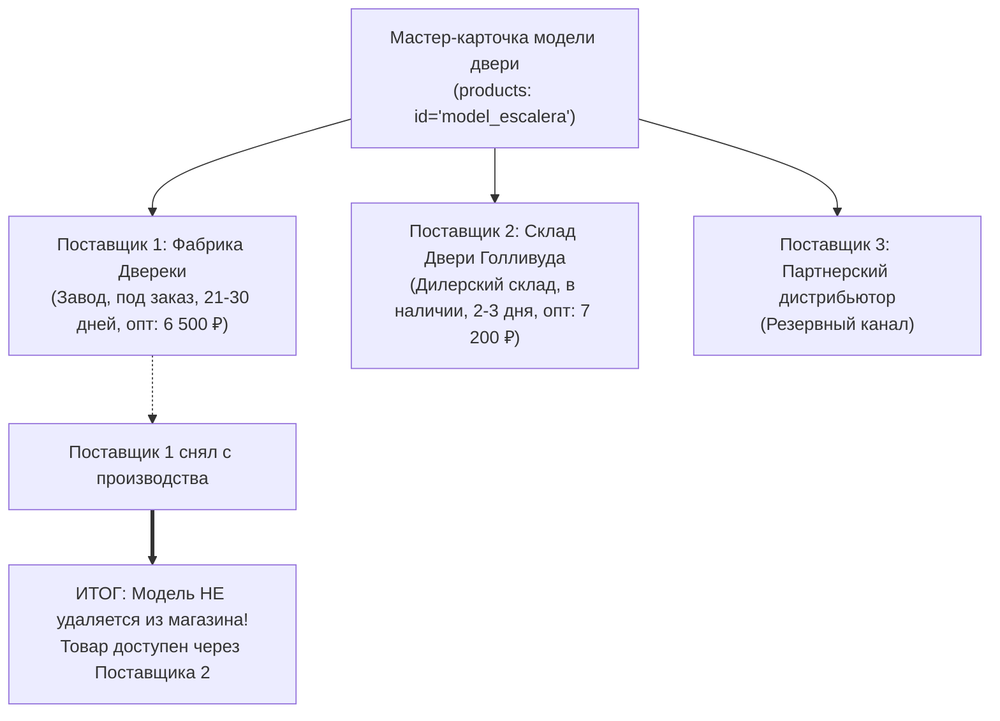
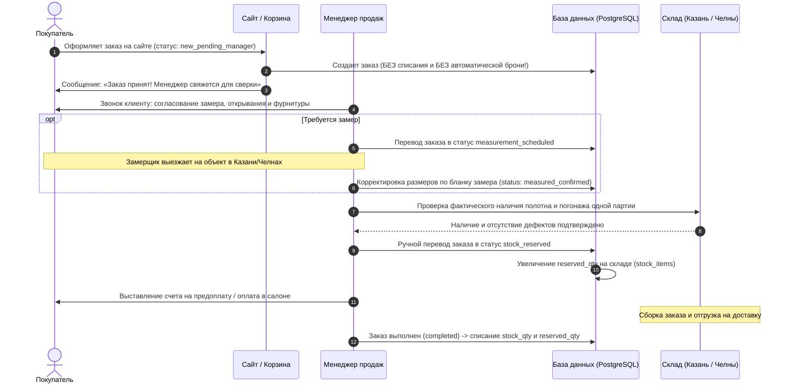

# РЕГЛАМЕНТ МУЛЬТИ-ПОСТАВЩИКОВ, СКЛАДСКОГО УЧЕТА И НАЛИЧИЯ (V2 FINAL)

**Проект:** Федеральный интернет-магазин «Двери №1»  
**Города присутствия:** Казань (Сибирский тракт, 59б), Набережные Челны (Казанский проспект, 232)  
**Версия документа:** 2.0 (Финальная ревизия складской и логистической архитектуры)  
**Статус:** Утверждено для проектирования сервисов складского учета, корзины и интеграции с поставщиками  

---

## 1. Архитектура работы с несколькими поставщиками (Multi-Supplier Core)

В дверном бизнесе одна и та же модель двери регулярно поставляется несколькими независимыми контрагентами: напрямую с завода-изготовителя (например, фабрика «Двереки») и через региональных оптовых дилеров (например, «Двери Голливуда», «Двери 2025»). При аудите каталогов выявлено **24 межмодельных кластера дублей**, где одни и те же модели присутствуют у разных поставщиков с разными сроками и условиями отгрузки.

### 1.1. Базовые правила модели поставщиков



1. **Неразрывность витрины:**  
   Витринная карточка (`products`) **никогда не удаляется автоматически** при отсутствии товара у одного из поставщиков. Если Поставщик А обнулил складские остатки или вывел модель из своей программы, система деактивирует только конкретную строку связи в таблице `product_suppliers` (`supplier_status = 'discontinued'`). Товар остается доступным для заказа через Поставщика Б.
2. **Снимок поставщика в заказе (Order Item Snapshot):**  
   Когда менеджер подтверждает заказ, в строке заказа `order_items` намертво фиксируется:
   - `product_supplier_id`: ID конкретного выбранного поставщика;
   - `supplier_name_snapshot`: название контрагента на момент покупки;
   - `supplier_article_snapshot`: фабричный артикул поставщика;
   - `purchase_price_snapshot`: оптовая цена закупки.  
   *Цель:* Защита финансовой отчетности, себестоимости и маржинальности заказа от любых будущих изменений условий поставщиков.
3. **Строгий запрет на выдумывание сроков доставки:**  
   Если в официальном договоре с поставщиком или прайс-листе не зафиксирован гарантированный регламентный срок поставки в днях, поле `lead_time_days` принимает значение `NULL`. На витрине покупателю выводится статус: **«Под заказ с фабрики (срок уточняется менеджером при звонке)»**. Любая генерация фиктивных сроков («3–5 дней») запрещена.

---

## 2. Раздельный учет по городам: Казань и Набережные Челны

Компания «Двери №1» располагает двумя независимыми логистическими центрами в Республике Татарстан.

### 2.1. Паспорт складских площадок

| Складской комплекс | Идентификатор в БД | Город | Физический адрес | Зона охвата | Режим перемещения |
| :--- | :--- | :--- | :--- | :--- | :--- |
| **Центральный хаб Казань** | `kazan_central` | г. Казань | ул. Сибирский тракт, 59б | г. Казань, Зеленодольск, Высокая Гора, Волжск | Базовый распределительный склад |
| **Региональный хаб Закамье** | `chelny_hub` | г. Набережные Челны | Казанский проспект, 232 | Набережные Челны, Нижнекамск, Елабуга, Альметьевск | Автономный региональный склад |

### 2.2. Архитектура изоляции складских остатков

Остатки Казани и Набережных Челнов хранятся строго в отдельных записях таблицы `stock_items`:

```sql
-- Пример записей в таблице stock_items:
-- Модель «Эскалера 2000х800 Белый эмалит» на двух складах
INSERT INTO stock_items (warehouse_id, item_type, item_id, stock_qty, reserved_qty, stock_status, manager_confirmation_required)
VALUES 
('kazan_central', 'door_variant', 'VAR-ESC-2000-800-WHT', 12, 4, 'in_stock', TRUE),
('chelny_hub',     'door_variant', 'VAR-ESC-2000-800-WHT',  0, 0, 'on_order_factory', TRUE);
```

#### Правила отображения для покупателя:
1. **Геотаргетинг покупателя:** При входе на сайт город покупателя определяется по геолокации или выбирается вручную в шапке сайта («Казань» или «Набережные Челны»).
2. **Локальное наличие:** Покупатель из Набережных Челнов видит статус наличия **исключительно на складе Набережных Челнов (Казанский проспект, 232)**. Если товар есть в Казани, но отсутствует в Челнах, статус отображается как: *«В наличии на складе в Казани (доставка в Набережные Челны 2–4 дня)»* либо *«Под заказ»*.
3. **Исключение ложных обещаний:** Запрещено выводить плашку «В наличии сегодня в Челнах», если товар физически находится на Сибирском тракте в Казани.

---

## 3. Модель разделения физического наличия и резервов

### 3.1. Формула доступного остатка

В таблице `stock_items` реализована строгая трехфакторная модель:

$$\mathbf{available\_qty} = \mathbf{stock\_qty} - \mathbf{reserved\_qty}$$

- $\mathbf{stock\_qty}$ (физический остаток): фактическое количество единиц товара, находящееся на поддонах и стеллажах склада;
- $\mathbf{reserved\_qty}$ (зарезервированный остаток): количество единиц, забронированное под уже согласованные и предоплаченные заказы клиентов;
- $\mathbf{available\_qty}$ (доступно к свободной продаже): генерируемое на уровне PostgreSQL поле `GENERATED ALWAYS AS (stock_qty - reserved_qty) STORED`.

Ограничение целостности базы данных:
$$\mathbf{reserved\_qty} \le \mathbf{stock\_qty} \quad \text{и} \quad \mathbf{available\_qty} \ge 0$$
(Попытка зарезервировать товар сверх физического остатка вызывает ошибку уровня СУБД).

### 3.2. Статусы складского наличия

| Статус в базе (`stock_status`) | Отображение на витрине | Описание и условия |
| :--- | :--- | :--- |
| `in_stock` | **«В наличии на складе»** | Товар физически на складе в городе покупателя, доступный остаток $> 0$. |
| `reserved` | **«В резерве (уточняйте)»** | Товар на складе есть, но весь доступный объем забронирован под заказы. |
| `on_order_factory` | **«Под заказ с фабрики»** | Товар изготавливается на заводе, срок уточняется менеджером. |
| `out_of_stock` | **«Временно отсутствует»** | Товар снят с оперативного запаса, ожидается поставка. |

---

## 4. Регламент ручного подтверждения заказа менеджером (`manager_confirmation_required`)

> [!CRITICAL]
> **Категорический запрет автосписания:**  
> В интернет-магазине «Двери №1» **строго запрещено автоматическое списание остатков** при нажатии покупателем кнопки «Оформить заказ» в корзине.  
> Флаг `manager_confirmation_required = TRUE` включен по умолчанию для всех товарных групп.

### 4.1. Почему автоматическое списание приведет к убыткам в дверном бизнесе:

1. **Необходимость профессионального замера:**  
   В 80% случаев замеры, сделанные покупателем самостоятельно рулеткой, расходятся с реальной геометрией проема (не учтен уклон стен по лазерному уровню, толщина будущей плитки или высота стяжки). В результате заказанное полотно 800 мм не войдет в проем, и потребуется полотно 700 мм. Автоматическое списание заблокирует остатки на складе ошибочным товаром.
2. **Разнотоны и партии покрытия:**  
   Межкомнатные двери, погонаж и плинтусы обязаны отгружаться **из одной производственной партии (номер партии/даты)**. Автосписание может собрать полотно из партии №14, а коробку из партии №18, что приведет к визуальному разнотону оттенков на объекте и отказу покупателя при приемке.
3. **Бракераж и пересортица:**  
   Физический осмотр кладовщиком перед постановкой в бронь исключает отгрузку полотна с поврежденной заводской упаковкой или царапиной.

### 4.2. Пошаговый сценарий жизненного цикла заказа



---

## 5. Межскладская логистика Казань ↔ Набережные Челны

1. **Регулярные рейсы перемещения:**  
   Между центральным складом Казани (Сибирский тракт, 59б) и складом в Челнах (Казанский проспект, 232) курсирует регулярный грузовой транспорт (вторник и пятница).
2. **Логика перемещения под заказ клиента:**  
   Если позиция есть на складе в Казани, но заказана клиентом в Набережных Челнах:
   - Менеджер ставит бронь на складе Казани (`warehouse_id = 'kazan_central'`);
   - Формируется внутренний логистический лист перемещения;
   - Срок готовности к выдаче в Челнах составляет от 2 до 4 рабочих дней;
   - Клиент уведомляется о дате прибытия машины на Казанский проспект.
