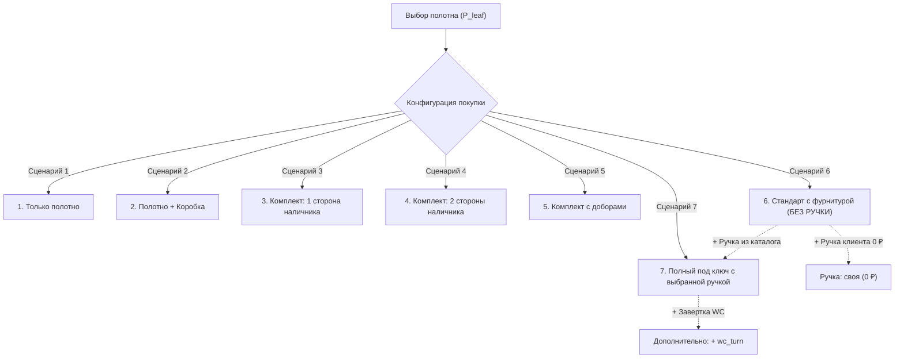

# ОДНОЗНАЧНЫЕ СЦЕНАРИИ КОМПЛЕКТАЦИИ И РАСЧЕТНЫЕ ПРАВИЛА (V3.1 FINAL)

**Проект:** Федеральный интернет-магазин «Двери №1»  
**Города присутствия:** Казань, Набережные Челны  
**Версия документа:** 3.1 (Устранение всех неоднозначностей комплектации и детальный разбор узлов)  
**Статус:** Утверждено для проектирования логики онлайн-конфигуратора и корзины  

---

## 1. Ответы на ключевые вопросы комплектации

### 1.1. Входят ли петли и замок в сценарии с погонажем?
> **ОТВЕТ: НЕТ, в сценарии с погонажем (Сценарии 2, 3, 4, 5) фурнитура автоматически НЕ входит.**  
> Сценарии 2–5 представляют собой чистые строительно-погонажные комплектации (полотно + коробка / наличники / доборы). Они предназначены для покупателей, у которых уже есть своя фурнитура (осталась от предыдущего ремонта, закуплена строителями оптом или снята со старых дверей).  
> Петли и замок включаются только тогда, когда покупатель явно переходит к выбору фурнитуры (Сценарий 6 или пошаговый выбор).

### 1.2. Можно ли выбрать комплект дверей вообще без фурнитуры?
> **ОТВЕТ: ДА, абсолютно.**  
> Покупатель может заказать:
> - Только полотно (Сценарий 1);
> - Полотно с коробкой (Сценарий 2);
> - Полотно с коробкой и наличниками на 1 сторону (Сценарий 3);
> - Полотно с коробкой и наличниками на 2 стороны (Сценарий 4);
> - Полотно с коробкой, наличниками и доборами (Сценарий 5),  
> оставив блок «Фурнитура» полностью отключенным. В этом случае в заказ попадут только полотно и стойки погонажа, а стоимость фурнитуры будет строго равна **0.00 ₽**.

### 1.3. Можно ли раздельно выбрать петли, замок и ручку?
> **ОТВЕТ: ДА, каждый элемент фурнитуры является независимым модулем:**
> 1. **Петли (Hinges):** покупатель может выбрать тип (накладные «бабочки» 100 мм, врезные универсальные или скрытые 3D) и количество (2 шт. стандартно, 3 шт. для тяжелых дверей). Может отказаться от петель вовсе.
> 2. **Замок / Защелка (Lock):** покупатель может выбрать бесшумный магнитный замок с ответной планкой, механическую защелку с пластиковым язычком либо отказаться от замка.
> 3. **Дверная ручка (Handle):** **НЕ входит в комплект автоматически**. Выбирается покупателем индивидуально из каталога (827 позиций) под цвет петель и интерьер либо клиент нажимает чекбокс «У меня своя ручка (0 ₽)».
> 4. **Сантехническая завертка (`wc_turn`)**: выбирается опционально по желанию клиента.

---

## 2. Детальный разбор назначения и расчета `wc_turn`

```
               [ Ручка дверная на розетке ]
                           │
                           │  Межосевое расстояние (96 мм / 70 мм)
                           ▼
          ┌───────────────────────────────────┐
          │   [ Поворотная завертка WC ]      │
          │   (снаружи: прорезь аварийного    │
          │             открывания)           │
          │   (изнутри: поворотный барашек)   │
          └───────────────────────────────────┘
```

### 2.1. Что это за комплектующая?
**`wc_turn` (сантехническая завертка, поворотная ручка-фиксатор, туалетный фиксатор)** — это декоративно-функциональный элемент фурнитуры, устанавливаемый на полотно двери на отдельной круглой или квадратной розетке строго под основной ручкой.

### 2.2. Зачем и когда она нужна?
1. **Назначение:** Служит для запирания межкомнатной двери изнутри помещения без использования ключа. При повороте барашка квадратный шток сечением 6×6 мм (или 8×8 мм с переходником) блокирует ригель магнитного или механического замка.
2. **Область применения:**
   - Санузлы, ванные комнаты и туалеты (в 95% случаев);
   - Спальни родителей и рабочие кабинеты (где требуется приватность).
3. **Безопасность (Emergency Release):** С наружной стороны розетки завертки обязательно выполнен аварийный шлиц под плоскую отвертку или монету. Если ребенок или пожилой человек случайно заблокирует дверь изнутри или почувствует себя плохо, замок можно легко открыть снаружи без повреждения двери.

### 2.3. Как рассчитывается стоимость `wc_turn`?
- **Единица измерения:** Штука (комплект на 1 дверь: внутренний барашек + внешний аварийный диск + шток + крепежные стяжки).
- **Привязка к стилю и цвету:** Завертка подбирается строго в одной коллекции и одном цвете с выбранной ручкой (например, если ручка *Morelli Luxury квадратная матовый черный*, завертка подбирается *Morelli квадратная матовый черный*).
- **Ценовой диапазон:** от 450 ₽ (FUARO/PUNTO) до 1 800+ ₽ (Morelli/Armadillo).
- **Формула:** В корзину добавляется отдельной строкой:
  $$P_{wc} = 1.0 \times P_{item\_wc}$$
- Для межкомнатных дверей в гостиную, кухню или детскую комнату завертка **не требуется** (используется глухая розетка-заглушка либо ручка без фиксатора).

---

## 3. Математический регламент 7 однозначных сценариев комплектации



### Сценарий 1: «Только полотно» (`leaf_only`)
Покупатель приобретает исключительно полотно. Погонаж = 0, фурнитура = 0.
$$\mathbf{P_{total} = P_{leaf}}$$

### Сценарий 2: «Полотно с коробкой» (`leaf_with_frame`)
Полотно + 2.5 стойки телескопической коробки. Наличники = 0, фурнитура = 0.
$$\mathbf{P_{total} = P_{leaf} + 2.5 \times P_{frame}}$$

### Сценарий 3: «Комплект с наличниками на 1 сторону» (`kit_casing_1side`)
Полотно + 2.5 стойки коробки + 2.5 стойки наличника. Фурнитура = 0. Применяется для санузлов, где плитка уложена встык с коробкой.
$$\mathbf{P_{total} = P_{leaf} + 2.5 \times P_{frame} + 2.5 \times P_{casing}}$$

### Сценарий 4: «Комплект с наличниками на 2 стороны» (`kit_casing_2sides`)
Полотно + 2.5 стойки коробки + 5.0 стоек наличника. Фурнитура = 0. Классический строительный комплект погонажа для стандартного проема.
$$\mathbf{P_{total} = P_{leaf} + 2.5 \times P_{frame} + 5.0 \times P_{casing}}$$

### Сценарий 5: «Комплект с доборами» (`kit_with_extensions`)
Полотно + 2.5 стойки коробки + 5.0 стоек наличника + 2.5 планки добора нужной ширины. Фурнитура = 0.  
Рассчитывается интерактивно при толщине стены $T_{wall} > 75$ мм:
$$\mathbf{P_{total} = P_{leaf} + 2.5 \times P_{frame} + 5.0 \times P_{casing} + 2.5 \times P_{ext}(W_{ext})}$$

### Сценарий 6: «Стандартный дверной блок с базовой фурнитурой» (`standard_kit_with_hardware`)
**ВНИМАНИЕ: РУЧКА В ЭТОТ КОМПЛЕКТ НЕ ВХОДИТ!**  
Полотно + 2.5 коробки + 5.0 наличников + 2 петли + 1 замок с ответной планкой.
$$\mathbf{P_{std\_kit} = P_{leaf} + 2.5 \times P_{frame} + 5.0 \times P_{casing} + 2 \times P_{hinge} + P_{lock}}$$
Покупатель получает полностью готовый к врезке блок, но сохраняет свободу: поставить свои ручки либо выбрать ручки на следующем шаге.

### Сценарий 7: «Полный комплект под ключ с выбранной ручкой» (`full_turnkey_kit`)
Стандартный комплект (Сценарий 6) + индивидуально выбранная ручка из каталога Morelli/Armadillo (+ опционально завертка WC).
$$\mathbf{P_{full} = P_{std\_kit} + P_{handle\_custom} + [P_{wc\_turn}]}$$

---

## 4. Расчет доборов и правила стыковки

Телескопическая коробка межкомнатной двери имеет стандартную базовую ширину **70–75 мм**. Если толщина стены в проеме превышает 75 мм, необходим доборный брус.

| Толщина стены проема ($T_{wall}$) | Необходимая ширина добора ($W_{ext}$) | Расход планок на 1 дверь | Комментарий технолога |
| :--- | :---: | :---: | :--- |
| **до 75 мм** | **0 мм (добор не нужен)** | 0 шт. | Перекрывается регулировочным шипом наличника (вылет шипа до 15 мм). |
| **76 – 120 мм** | **100 мм** | **2.5 планки** | Стойка добора распиливается вдоль по месту монтажником под точный размер. |
| **121 – 170 мм** | **150 мм** | **2.5 планки** | Стандартная глубина для кирпичных межкомнатных перегородок. |
| **171 – 220 мм** | **200 мм** | **2.5 планки** | Для глубоких проемов в несущих стенах. |
| **свыше 220 мм** | **Составной добор (150 + 100 мм)** | **5.0 планок + Н-профиль** | Две планки добора состыковываются вдоль через двухсторонний Н-образный паз. |

---

## 5. Защита от двойного учета элементов

В кодовой базе интернет-магазина и схеме БД двойной учет предотвращается на трех уровнях:

1. **Атомарность строк в заказе:**  
   Полотно, стойки коробки, наличники, доборы, петли, замок и ручка сохраняются в `order_items` строго отдельными строками со своим `item_kind` (`door_leaf`, `frame`, `casing`, `extension`, `hinge`, `lock`, `handle`, `wc_turn`). Никакой агрегатной строки «Комплект за 25 000 ₽», внутри которой скрыты вторые петли, не существует.
2. **Входные двери (`monolithic_block`):**  
   Для металлических дверей коробка, наличники и замки уже включены заводом в блок. Попытка добавить деревянный погонаж блокируется на уровне схемы БД:
   ```sql
   -- Триггерная валидация: к моноблоку нельзя добавить стойки погонажа
   IF v_product.pricing_type = 'monolithic_block' AND NEW.item_kind IN ('frame', 'casing', 'extension') THEN
       RAISE EXCEPTION 'К входной монолитной двери запрещено добавлять погонажные изделия';
   END IF;
   ```
3. **Скрытые двери (`invisible_kit`):**  
   Для скрытых дверей наличники и доборы физически не могут быть добавлены в корзину (на коробе нет телескопического паза). В интерфейсе вкладка погонажа аппаратно скрывается, а API блокирует такие запросы.
