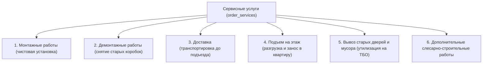

# КЛАССИФИКАТОР СЕРВИСНЫХ УСЛУГ И БИЗНЕС-ПРАВИЛА (V3.1 FINAL)

**Проект:** Федеральный интернет-магазин «Двери №1»  
**Города присутствия:** Казань, Набережные Челны  
**Версия документа:** 3.1 (Сверка категорий сервиса с технологическими регламентами монтажа)  
**Статус:** Утверждено для проектирования модуля услуг и наряд-заказов монтажников  

---

## 1. Технологическое разделение категорий услуг

В строительно-дверном сервисе объединение технологически разнородных услуг в один «пакет» приводит к кассовым разрывам, конфликтам монтажников с клиентами и спорам о зоне ответственности.

В архитектуре базы данных «Двери №1» категории сервиса разделены на **6 независимых технологических групп**.



---

## 2. Почему демонтаж и вывоз мусора обязаны быть раздельными услугами

> [!IMPORTANT]
> **Принципиальное различие:**  
> **Демонтаж (`dismantling`)** и **Вывоз старых дверей/мусора (`debris_disposal`)** представляют собой две абсолютно разные производственные операции с разной квалификацией, инструментом и логистикой:

| Критерий | Демонтаж старой двери (`dismantling`) | Вывоз старых дверей и мусора (`debris_disposal`) |
| :--- | :--- | :--- |
| **Кто выполняет** | Квалифицированный мастер-монтажник дверей. | Грузчики и водитель грузового транспорта / компании-утилизатора. |
| **Инструмент** | Монтировка, сабельная пила, перфоратор, стамеска, шуруповерт. | Грузовой фургон (Газель), строительные мешки, перчатки, тележка. |
| **Суть работы** | Аккуратное снятие старых створок, распил старой деревянной/стальной коробки, сохранение проема и штукатурки. | Спуск старых полотен, коробок, мешков со штукатуркой и транспортировка на лицензированный полигон ТБО. |
| **Правовой статус** | Строительно-отделочная услуга в жилом помещении. | Обращение с крупногабаритными отходами (КГО). Выброс старых дверей на придомовую помойку запрещен законом РФ (штраф до 50 000 ₽). |
| **Потребность клиента**| Нужен в 90% вторичного жилья. | Нужен не всем: часть клиентов оставляет старые двери для дачи, гаража или утилизирует своими силами. |

**Вывод:** Навязывание вывоза мусора в стоимости демонтажа снижает конверсию, а выполнение вывоза силами легкового автомобиля монтажника физически невозможно. Услуги оформляются раздельными строками.

---

## 3. Официальный классификатор сервисных услуг для БД

В таблице `order_services` поле `service_type` строго ограничено перечнем проверенных категорий:

```sql
CONSTRAINT chk_service_type CHECK (
    service_type IN (
        -- 1. Замер проемов
        'measurement',
        
        -- 2. Доставка
        'delivery_city',          -- Доставка в черте Казани / Набережных Челнов
        'delivery_suburb',        -- Доставка за черту города (за км от знака границы города)
        
        -- 3. Подъем на этаж
        'floor_carry_elevator',   -- Занос на грузовом лифте (фиксированный тариф)
        'floor_carry_stairs',     -- Ручной подъем по лестнице (расчет: за этаж × количество блоков)
        
        -- 4. Демонтажные работы
        'dismantling_interior',   -- Демонтаж старой межкомнатной двери
        'dismantling_metal',      -- Демонтаж старой стальной входной двери
        
        -- 5. Монтажные работы
        'installation_interior',  -- Монтаж межкомнатного дверного блока (сборка короба, врезка петель/замка, навес, наличники)
        'installation_extension', -- Установка комплекта доборов
        'installation_invisible', -- Монтаж скрытого короба Invisible в черновой проем
        'installation_metal',     -- Монтаж входной стальной двери на анкера со сваркой
        
        -- 6. Вывоз и утилизация
        'debris_disposal',        -- Спуск, погрузка и вывоз старых дверей и строительного мусора на полигон ТБО
        
        -- 7. Дополнительные работы
        'extra_wall_expansion',   -- Расширение проема (резка бетона / кирпича)
        'extra_leaf_trim'         -- Подрезка полотна по высоте (для нестандартных полов)
    )
)
```

---

## 4. Бизнес-правила тарификации и отказ от выдуманных цен

В соответствии с регламентом ТЗ проектировщик **не придумывает произвольные цены**. В архитектуре системы заложены следующие правила:

1. **Тарифная сетка по городам:**  
   Тарифы на услуги утверждаются коммерческим директором в панели администратора раздельно для Казани и Набережных Челнов.
2. **Бесплатный замер при заключении договора:**  
   Стоимость первичного выезда замерщика (например, 500 ₽) включается в наряд-заказ. При подписании договора на монтаж данная сумма автоматически вычитается в виде сервисной скидки в чеке.
3. **Раздельная ответственность и закрывающие акты:**  
   Для услуг формируется отдельный акт сдачи-приемки выполненных работ (форма КС-2 / индивидуальный акт сервиса), подписанный заказчиком и сертифицированным мастером-монтажником.
