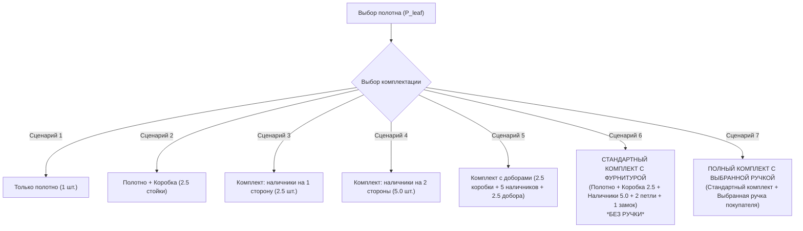

# ОКОНЧАТЕЛЬНАЯ ЛОГИКА КОМПЛЕКТАЦИИ И РАСЧЕТНЫЕ ФОРМУЛЫ (V3 FINAL)

**Проект:** Федеральный интернет-магазин «Двери №1»  
**Города присутствия:** Казань, Набережные Челны  
**Версия документа:** 3.0 (Финальная ревизия с математически строгими формулами и исключением ручки)  
**Статус:** Утверждено для реализации логики конфигуратора и корзины  

---

## 1. Базовые принципы и предотвращение двойного учета

В дверном ритейле расчет стоимости комплекта сопряжен с рисками скрытого завышения цены или дублирования элементов. В версии V3 зафиксированы следующие нерушимые правила:

1. **Ручка НЕ входит в автоматическую комплектацию:**  
   Ручка является сугубо индивидуальным дизайнерским выбором покупателя. При расчете стандартного заводского комплекта ручка **НЕ прибавляется**. Покупатель может:
   - выбрать конкретную модель и цвет ручки из каталога фурнитуры (с доплатой за выбранный артикул);
   - либо указать опцию «У меня своя ручка (0 ₽)».
2. **Стандартный комплект межкомнатной двери включает:**
   - 1 дверное полотно (`leaf`);
   - 2.5 стойки телескопической коробки (`frame`);
   - 5.0 стоек телескопического наличника на 2 стороны (`casing`);
   - 2 петли (накладные «бабочки» или универсальные врезные, `hinge`);
   - 1 врезной замок (магнитный или механический) с ответной планкой в короб (`lock`).
3. **Строгая защита от двойного учета:**  
   Каждый элемент заказа является атомарным. Если покупатель переключает конфигурацию с «Только полотно» на «Комплект с наличниками на 1 сторону», система не создает дублирующих строк, а изменяет коэффициент наличника с $0.0$ на $2.5$.
4. **Неделимость входных моноблоков:**  
   Для металлических дверей коробка, наличник, 3 петли на подшипниках и 2 замка входят в состав моноблока на заводе. Любое повторное начисление стоимости короба или петель аппаратно заблокировано.

---

## 2. Модель 1: Межкомнатные двери (`modular_kit`) — Все сценарии и формулы

### Формулы расчета по сценариям:

#### Сценарий 1: «Только полотно» (`leaf_only`)
Покупка одного дверного полотна без погонажа и без фурнитуры (замена поврежденного полотна в старый проем, раздвижная система-купе).
$$P_{total} = P_{leaf}$$
*Где:*
- $P_{leaf}$ — базовая стоимость полотна выбранного размера и цвета (с учетом надбавки за нестандартный размер `price_delta`).

#### Сценарий 2: «Полотно с коробкой» (`leaf_with_frame`)
Полотно и 2.5 стойки телескопической коробки без наличников (проемы под чистовую отделку кафелем, скрытый штукатурный уголок).
$$P_{total} = P_{leaf} + 2.5 \times P_{frame}$$
*Где:*
- $P_{frame}$ — цена за 1 стойку телескопической коробки (2070 мм);
- Коэффициент $2.5$ отражает 2 вертикальные стойки и 1 верхнюю перекладину (половина стойки).

#### Сценарий 3: «Комплект с наличниками на 1 сторону» (`kit_casing_1side`)
Полотно + 2.5 стойки коробки + 2.5 стойки наличника (для санузлов и ванных комнат, где изнутри проем отделан плиткой под срез короба).
$$P_{total} = P_{leaf} + 2.5 \times P_{frame} + 2.5 \times P_{casing}$$
*Где:*
- $P_{casing}$ — цена за 1 стойку плоского или фигурного наличника.

#### Сценарий 4: «Комплект с наличниками на 2 стороны» (`kit_casing_2sides`)
Полотно + 2.5 стойки коробки + 5.0 стоек наличника (базовый комплект погонажа для стандартной межкомнатной перегородки толщиной до 75 мм без врезанной фурнитуры).
$$P_{total} = P_{leaf} + 2.5 \times P_{frame} + 5.0 \times P_{casing}$$

#### Сценарий 5: «Комплект с доборами» (`kit_with_extensions`)
Полотно + 2.5 стойки коробки + 5.0 стоек наличника + 2.5 планки телескопического добора (при толщине стены проема свыше 75 мм).
$$P_{total} = P_{leaf} + 2.5 \times P_{frame} + 5.0 \times P_{casing} + 2.5 \times P_{ext}(W_{ext})$$
*Определение ширины добора $W_{ext}$ в зависимости от толщины стены $T_{wall}$:*
- При $T_{wall} \le 75$ мм: добор **не нужен** (телескопический шип наличника перекрывает зазор);
- При $76 \le T_{wall} \le 120$ мм: добор шириной **100 мм**;
- При $121 \le T_{wall} \le 170$ мм: добор шириной **150 мм**;
- При $171 \le T_{wall} \le 220$ мм: добор шириной **200 мм**;
- При $T_{wall} > 220$ мм: стыковка двух доборов через Н-образный соединитель:
  $$P_{total} = P_{leaf} + 2.5 \times P_{frame} + 5.0 \times P_{casing} + 2.5 \times P_{ext1} + 2.5 \times P_{ext2} + 2.5 \times P_{h\_beam}$$

#### Сценарий 6: «Стандартный комплект двери с фурнитурой» (`standard_kit_with_hardware`)
**СТРОГО ПО СОГЛАСОВАННОЙ БИЗНЕС-ЛОГИКЕ: РУЧКА НЕ ВКЛЮЧЕНА!**  
Полотно + 2.5 стойки коробки + 5.0 стоек наличника + 2 петли + 1 замок с магнитной или пластиковой защелкой и ответной планкой.
$$P_{std\_kit} = P_{leaf} + 2.5 \times P_{frame} + 5.0 \times P_{casing} + 2 \times P_{hinge} + P_{lock}$$
*Параметры фурнитуры:*
- $P_{hinge}$ — цена 1 петли (в комплекте ровно 2 штуки на стандартное полотно весом до 30 кг);
- $P_{lock}$ — цена замка с ответной планкой в короб (AGB Mediana Polaris, Morelli M1885 или аналог).

#### Сценарий 7: «Полный комплект под ключ с выбранной ручкой» (`full_turnkey_kit`)
Стандартный комплект (Сценарий 6) + **отдельно выбранная покупателем ручка** (+ опционально сантехническая завертка WC / накладка под цилиндр).
$$P_{full} = P_{std\_kit} + P_{handle\_custom} + [P_{wc\_turn}]$$
*Где:*
- $P_{handle\_custom}$ — стоимость конкретной ручки, выбранной покупателем из каталога Morelli / Armadillo / FUARO;
- Если покупатель нажал «У меня своя ручка», $P_{handle\_custom} = 0.00$ ₽.

---

## 3. Модель 2: Входные стальные двери (`monolithic_block`)

### 3.1. Формула неделимого моноблока
$$P_{total} = P_{monolithic\_block} + [P_{smart\_lock\_upgrade}]$$

### 3.2. Правила защиты от двойного учета:
1. Полотно, стальной утепленный короб, приварные петли на упорных подшипниках (3 шт.), основной сувальдный замок, дополнительный цилиндровый замок, ночная задвижка и интегрированный металлический наличник **составляют единое целое**.
2. В схеме БД `products.base_leaf_price` для входных дверей строго равен `NULL`.
3. Попытка добавить деревянный погонаж (коробки, наличники, доборы) или петли из межкомнатного раздела к позиции `monolithic_block` блокируется ограничением уровня БД `chk_order_item_single_target` и валидатором API.

---

## 4. Модель 3: Скрытые двери (`invisible_kit`)

### 4.1. Формула комплекта скрытого монтажа
$$P_{total} = P_{inv\_leaf\_and\_frame} + 2 \times P_{concealed\_3d\_hinge} + P_{magnetic\_lock} + [P_{handle\_custom}]$$

### 4.2. Правила комплектации Invisible:
1. **Состав заводского комплекта:**
   - Грунтованное полотно под покраску/обои (толщина 38–44 мм);
   - Анодированный алюминиевый скрытый короб под шпаклевку;
   - 2 скрытые регулируемые 3D-петли (хром или черный);
   - 1 магнитный замок с ответной планкой в алюминиевый короб.
2. **Абсолютный запрет погонажа:**
   Наличники и стандартные доборы **категорически запрещены**. На коробке Invisible нет паза под телескопический наличник. В конфигураторе вкладка погонажа скрыта.
3. **Обязательный выбор геометрии открывания:**
   - **Direct (на себя):** открывание наружу, прямое полотно;
   - **Reverse (от себя):** открывание внутрь проема, полотно с реверсивной четвертью (фальцем) и Z-образный профиль скрытого короба.
4. **Выбор ручки:**
   Ручка выбирается отдельно (рекомендуются серии на ультратонких розетках толщиной 3–6 мм).

---

## 5. Сводная сравнительная таблица расхода элементов

| Элемент комплектации | Только полотно | Полотно + коробка | Комплект (1 ст. наличника) | Комплект (2 ст. наличника) | Комплект с доборами | Стандарт с фурнитурой | Полный с ручкой |
| :--- | :---: | :---: | :---: | :---: | :---: | :---: | :---: |
| **Полотно (шт.)** | 1.0 | 1.0 | 1.0 | 1.0 | 1.0 | 1.0 | 1.0 |
| **Коробка (стойки)** | 0.0 | 2.5 | 2.5 | 2.5 | 2.5 | 2.5 | 2.5 |
| **Наличники (стойки)**| 0.0 | 0.0 | 2.5 | 5.0 | 5.0 | 5.0 | 5.0 |
| **Доборы (планки)** | 0.0 | 0.0 | 0.0 | 0.0 | 2.5 | 0.0 *(или 2.5)*| 0.0 *(или 2.5)*|
| **Петли (шт.)** | 0.0 | 0.0 | 0.0 | 0.0 | 0.0 | **2.0** | **2.0** |
| **Замок с планкой (шт.)**| 0.0 | 0.0 | 0.0 | 0.0 | 0.0 | **1.0** | **1.0** |
| **Ручка дверная (шт.)**| 0.0 | 0.0 | 0.0 | 0.0 | 0.0 | **0.0 (Отдельно!)**| **1.0 (Выбор клиента)**|
| **Завертка WC (шт.)** | 0.0 | 0.0 | 0.0 | 0.0 | 0.0 | 0.0 | Опционально (+1) |
