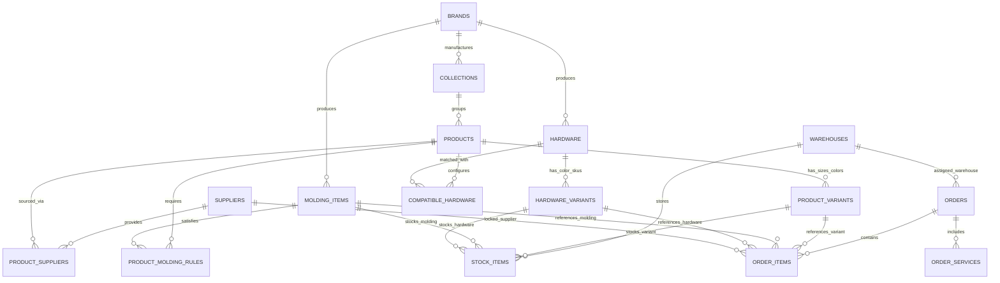

# ИСПРАВЛЕННАЯ ПОЛНАЯ АРХИТЕКТУРНАЯ СХЕМА БАЗЫ ДАННЫХ И DDL (V3 FINAL)

**Проект:** Федеральный интернет-магазин «Двери №1»  
**Города присутствия:** Казань (Сибирский тракт, 59б), Набережные Челны (Казанский проспект, 232)  
**Версия документа:** 3.0 (Финальный технический DDL с гарантией ссылочной целостности)  
**Статус:** Утвержденная инженерная схема (БЕЗ создания таблиц в рабочей СУБД и запуска миграций на данном этапе)  

---

## 1. Анализ дефектов схемы V2 и архитектурные исправления

В предыдущей ревизии (V2) были выявлены два критических недостатка, нарушавших принципы реляционной целостности СУБД:
1. **Псевдополиморфная связь в `stock_items` и `order_items` (`item_type + item_id`):**  
   - *Что было раньше:* Хранение внешнего ключа в виде текстовой пары `item_type VARCHAR(32) + item_id VARCHAR(64)`.
   - *Почему это недопустимо:* СУБД PostgreSQL не может контролировать ссылочную целостность (`FOREIGN KEY`) по текстовому полю. Становилось возможным создать складской остаток для несуществующего товара, добавить в заказ удаленный артикул или допустить опечатку в ID, не отслеживаемую базой данных.
   - *Что изменено в V3:* Реализован паттерн **явных типизированных внешних ключей с ограничением взаимоисключения** (`Exclusive Arc / Mutually Exclusive Foreign Keys`):
     ```sql
     variant_id VARCHAR(64) REFERENCES product_variants(id) ON DELETE RESTRICT,
     molding_id VARCHAR(64) REFERENCES molding_items(id) ON DELETE RESTRICT,
     hardware_variant_id VARCHAR(64) REFERENCES hardware_variants(id) ON DELETE RESTRICT,
     CONSTRAINT chk_stock_single_item CHECK (
         num_nonnulls(variant_id, molding_id, hardware_variant_id) = 1
     )
     ```
     Это на 100% гарантирует ссылочную целостность на уровне ядра PostgreSQL: ни один остаток или строка заказа не могут быть созданы без реальной родительской записи.
2. **Смешение сущностей Производителей (`brands`) и Поставщиков (`suppliers`):**  
   - *Что было раньше:* В таблице `product_suppliers` поставщик ссылался на `brands(id)` (`supplier_brand_id`).
   - *Почему это недопустимо:* Фабрика-производитель (бренд) и юридическое лицо / склад-дистрибьютор (поставщик) — принципиально разные сущности. Одна фабрика (например, «Двереки») может отгружаться напрямую и через дилеров («Двери Голливуда», «ТК Двери-Опт»). Один дилер может поставлять продукцию нескольких фабрик.
   - *Что изменено в V3:* Выделена независимая сущность `suppliers` (поставщики, дистрибьюторы, склады) и нормализованная связь $M : N$ через `product_suppliers`.

---

## 2. Диаграмма связей сущностей (Entity-Relationship Diagram V3)



---

## 3. Полный производственный PostgreSQL DDL (V3 Final)

```sql
-- ============================================================================
-- БАЗА ДАННЫХ ИНТЕРНЕТ-МАГАЗИНА «ДВЕРИ №1» (V3 FINAL)
-- СУБД: PostgreSQL 14+ / 15+ / 16+
-- Полный DDL с гарантией ссылочной целостности, триггерами и хранимыми процедурами
-- ============================================================================

CREATE EXTENSION IF NOT EXISTS "uuid-ossp";
CREATE EXTENSION IF NOT EXISTS "citext";

-- ============================================================================
-- 1. ПРОИЗВОДИТЕЛИ И БРЕНДЫ (BRANDS)
-- ============================================================================
CREATE TABLE brands (
    id VARCHAR(64) PRIMARY KEY,
    name VARCHAR(255) NOT NULL,
    country VARCHAR(100) NOT NULL,
    description TEXT,
    logo_url VARCHAR(500),
    is_active BOOLEAN NOT NULL DEFAULT TRUE,
    created_at TIMESTAMP WITH TIME ZONE NOT NULL DEFAULT CURRENT_TIMESTAMP,
    updated_at TIMESTAMP WITH TIME ZONE NOT NULL DEFAULT CURRENT_TIMESTAMP
);

COMMENT ON TABLE brands IS 'Фабрики и заводы-изготовители дверной продукции и фурнитуры';

-- ============================================================================
-- 2. ПОСТАВЩИКИ И ДИСТРИБЬЮТОРЫ (SUPPLIERS)
-- Выделенная сущность, отделенная от брендов-производителей
-- ============================================================================
CREATE TABLE suppliers (
    id VARCHAR(64) PRIMARY KEY,
    name VARCHAR(255) NOT NULL,              -- Коммерческое наименование (например: 'Двери Голливуда Опт')
    legal_name VARCHAR(255),                 -- Юридическое лицо (ООО / ИП)
    inn VARCHAR(12),                         -- ИНН для бухгалтерской сверки
    contact_person VARCHAR(255),
    phone VARCHAR(50),
    email VARCHAR(255),
    city VARCHAR(100) NOT NULL,              -- Базовый город склада поставщика
    warehouse_address VARCHAR(255),          -- Физический адрес отгрузки
    default_lead_time_days INT NULL,         -- Регламентный срок (если зафиксирован в договоре, иначе NULL)
    is_active BOOLEAN NOT NULL DEFAULT TRUE,
    notes TEXT,
    created_at TIMESTAMP WITH TIME ZONE NOT NULL DEFAULT CURRENT_TIMESTAMP,
    updated_at TIMESTAMP WITH TIME ZONE NOT NULL DEFAULT CURRENT_TIMESTAMP
);

COMMENT ON TABLE suppliers IS 'Контрагенты, оптовые склады и дистрибьюторы продукции';

-- ============================================================================
-- 3. КОЛЛЕКЦИИ (COLLECTIONS)
-- ============================================================================
CREATE TABLE collections (
    id VARCHAR(64) PRIMARY KEY,
    brand_id VARCHAR(64) NOT NULL REFERENCES brands(id) ON DELETE RESTRICT,
    name VARCHAR(255) NOT NULL,
    category VARCHAR(100) NOT NULL,
    description TEXT,
    is_active BOOLEAN NOT NULL DEFAULT TRUE,
    created_at TIMESTAMP WITH TIME ZONE NOT NULL DEFAULT CURRENT_TIMESTAMP,
    updated_at TIMESTAMP WITH TIME ZONE NOT NULL DEFAULT CURRENT_TIMESTAMP,
    CONSTRAINT chk_collection_category CHECK (
        category IN ('Входные двери', 'Межкомнатные двери', 'Скрытые двери', 'Фурнитура', 'Специальные двери')
    )
);

-- ============================================================================
-- 4. МАСТЕР-КАРТОЧКИ ТОВАРОВ (PRODUCTS)
-- ============================================================================
CREATE TABLE products (
    id VARCHAR(64) PRIMARY KEY,
    brand_id VARCHAR(64) NOT NULL REFERENCES brands(id) ON DELETE RESTRICT,
    collection_id VARCHAR(64) NOT NULL REFERENCES collections(id) ON DELETE RESTRICT,
    model_name VARCHAR(255) NOT NULL,
    category VARCHAR(100) NOT NULL,
    door_type VARCHAR(100),
    construction VARCHAR(255),
    coating_type VARCHAR(100),
    style VARCHAR(100),
    has_glass BOOLEAN NOT NULL DEFAULT FALSE,
    glass_type VARCHAR(255),
    
    -- Конструктивно-ценовая модель:
    -- 'monolithic_block' - неделимый блок входной двери (цена полотна и короба неделима)
    -- 'modular_kit'      - межкомнатный комплект (раздельный расчет полотна, погонажа и фурнитуры)
    -- 'invisible_kit'    - скрытая дверь (полотно под грунт + алюминиевый скрытый короб + замок + 3D петли)
    pricing_type VARCHAR(32) NOT NULL,
    
    base_leaf_price NUMERIC(10,2) NULL,
    base_kit_price NUMERIC(10,2) NULL,
    price_status VARCHAR(32) NOT NULL DEFAULT 'quote', -- 'fixed', 'from', 'quote'
    is_active BOOLEAN NOT NULL DEFAULT TRUE,
    created_at TIMESTAMP WITH TIME ZONE NOT NULL DEFAULT CURRENT_TIMESTAMP,
    updated_at TIMESTAMP WITH TIME ZONE NOT NULL DEFAULT CURRENT_TIMESTAMP,
    
    CONSTRAINT chk_product_pricing_type CHECK (
        pricing_type IN ('monolithic_block', 'modular_kit', 'invisible_kit')
    ),
    CONSTRAINT chk_product_price_status CHECK (
        price_status IN ('fixed', 'from', 'quote')
    )
);

COMMENT ON TABLE products IS 'Витринные мастер-модели дверей для клиентского каталога';

-- ============================================================================
-- 5. ИСТОЧНИКИ ПОСТАВКИ МАСТЕР-ТОВАРА (PRODUCT_SUPPLIERS)
-- Реализует отношение M:N между моделями дверей и поставщиками
-- ============================================================================
CREATE TABLE product_suppliers (
    id SERIAL PRIMARY KEY,
    product_id VARCHAR(64) NOT NULL REFERENCES products(id) ON DELETE CASCADE,
    supplier_id VARCHAR(64) NOT NULL REFERENCES suppliers(id) ON DELETE RESTRICT,
    supplier_article VARCHAR(100),           -- Артикул в прайсе данного поставщика
    catalog_name VARCHAR(255) NOT NULL,      -- Название печатного/электронного каталога
    catalog_page INT NOT NULL,               -- Страница каталога
    purchase_price NUMERIC(10,2) NULL,       -- Оптовая цена закупки
    is_primary BOOLEAN NOT NULL DEFAULT FALSE,
    
    -- Статус источника:
    -- 'active'      - регулярная складская программа поставщика
    -- 'on_order'    - поставка под заказ с фабрики
    -- 'discontinued'- снято с производства данным поставщиком (не удаляет мастер-карточку!)
    supplier_status VARCHAR(32) NOT NULL DEFAULT 'on_order',
    lead_time_days INT NULL,                 -- NULL = «уточняется менеджером», запрет фиктивных сроков
    notes TEXT,
    created_at TIMESTAMP WITH TIME ZONE NOT NULL DEFAULT CURRENT_TIMESTAMP,
    updated_at TIMESTAMP WITH TIME ZONE NOT NULL DEFAULT CURRENT_TIMESTAMP,
    
    CONSTRAINT chk_product_supplier_status CHECK (
        supplier_status IN ('active', 'on_order', 'discontinued')
    ),
    CONSTRAINT uq_product_supplier UNIQUE (product_id, supplier_id)
);

COMMENT ON TABLE product_suppliers IS 'Матрица поставок модели несколькими независимыми поставщиками';

-- ============================================================================
-- 6. ВАРИАНТЫ ИСПОЛНЕНИЯ ПОЛОТЕН (PRODUCT_VARIANTS)
-- ============================================================================
CREATE TABLE product_variants (
    id VARCHAR(64) PRIMARY KEY,
    product_id VARCHAR(64) NOT NULL REFERENCES products(id) ON DELETE CASCADE,
    sku VARCHAR(100) UNIQUE NOT NULL,
    height_mm INT NOT NULL,
    width_mm INT NOT NULL,
    thickness_mm INT NOT NULL DEFAULT 38,
    outside_color VARCHAR(255) NOT NULL,
    inside_color VARCHAR(255),
    is_composite_color BOOLEAN NOT NULL DEFAULT FALSE,
    opening_direction VARCHAR(32) NOT NULL DEFAULT 'universal', -- 'universal', 'left', 'right', 'direct', 'reverse'
    image_url VARCHAR(500),
    price_delta NUMERIC(10,2) NOT NULL DEFAULT 0.00,
    is_available BOOLEAN NOT NULL DEFAULT TRUE,
    created_at TIMESTAMP WITH TIME ZONE NOT NULL DEFAULT CURRENT_TIMESTAMP,
    updated_at TIMESTAMP WITH TIME ZONE NOT NULL DEFAULT CURRENT_TIMESTAMP,
    
    CONSTRAINT chk_variant_opening_dir CHECK (
        opening_direction IN ('universal', 'left', 'right', 'direct', 'reverse')
    ),
    CONSTRAINT chk_variant_dims CHECK (
        height_mm BETWEEN 1500 AND 3000 AND width_mm BETWEEN 300 AND 1400 AND thickness_mm BETWEEN 30 AND 160
    )
);

-- ============================================================================
-- 7. НОМЕНКЛАТУРА ПОГОНАЖНЫХ ИЗДЕЛИЙ (MOLDING_ITEMS)
-- Штучный товар со своей ценой за стойку/планку
-- ============================================================================
CREATE TABLE molding_items (
    id VARCHAR(64) PRIMARY KEY,
    brand_id VARCHAR(64) NOT NULL REFERENCES brands(id) ON DELETE RESTRICT,
    article VARCHAR(100) UNIQUE,
    molding_type VARCHAR(64) NOT NULL, -- 'frame', 'casing', 'extension', 'plinth', 'invisible_frame', 'false_beam'
    name VARCHAR(255) NOT NULL,
    coating_type VARCHAR(100),
    color VARCHAR(255) NOT NULL,
    length_mm INT NOT NULL DEFAULT 2070,
    width_mm INT NOT NULL,
    thickness_mm INT NOT NULL,
    unit VARCHAR(16) NOT NULL DEFAULT 'pc',
    unit_price NUMERIC(10,2) NULL,
    price_status VARCHAR(32) NOT NULL DEFAULT 'quote',
    is_active BOOLEAN NOT NULL DEFAULT TRUE,
    created_at TIMESTAMP WITH TIME ZONE NOT NULL DEFAULT CURRENT_TIMESTAMP,
    updated_at TIMESTAMP WITH TIME ZONE NOT NULL DEFAULT CURRENT_TIMESTAMP,
    
    CONSTRAINT chk_molding_type CHECK (
        molding_type IN ('frame', 'casing', 'extension', 'plinth', 'invisible_frame', 'false_beam')
    ),
    CONSTRAINT chk_molding_unit CHECK (
        unit IN ('pc', 'set', 'meter')
    )
);

-- ============================================================================
-- 8. НОРМАТИВЫ КОМПЛЕКТАЦИИ ПОГОНАЖЕМ (PRODUCT_MOLDING_RULES)
-- ============================================================================
CREATE TABLE product_molding_rules (
    id SERIAL PRIMARY KEY,
    product_id VARCHAR(64) NOT NULL REFERENCES products(id) ON DELETE CASCADE,
    molding_item_id VARCHAR(64) NOT NULL REFERENCES molding_items(id) ON DELETE RESTRICT,
    role VARCHAR(32) NOT NULL, -- 'default_frame', 'default_casing', 'decorative_casing', 'compatible_extension', 'invisible_frame'
    default_quantity NUMERIC(4,2) NOT NULL, -- 2.5 для коробки, 2.5 / 5.0 для наличников
    is_required BOOLEAN NOT NULL DEFAULT FALSE,
    created_at TIMESTAMP WITH TIME ZONE NOT NULL DEFAULT CURRENT_TIMESTAMP,
    
    CONSTRAINT chk_molding_role CHECK (
        role IN ('default_frame', 'default_casing', 'decorative_casing', 'compatible_extension', 'invisible_frame')
    ),
    CONSTRAINT uq_product_molding_rule UNIQUE (product_id, molding_item_id, role)
);

-- ============================================================================
-- 9. КАТАЛОГ БАЗОВОЙ ФУРНИТУРЫ (HARDWARE)
-- ============================================================================
CREATE TABLE hardware (
    id VARCHAR(64) PRIMARY KEY,
    brand_id VARCHAR(64) NOT NULL REFERENCES brands(id) ON DELETE RESTRICT,
    collection_name VARCHAR(255),
    model_name VARCHAR(255) NOT NULL,
    hardware_type VARCHAR(64) NOT NULL,
    material VARCHAR(100),
    rosette_thickness_mm INT DEFAULT 6,
    door_thickness_min INT DEFAULT 35,
    door_thickness_max INT DEFAULT 55,
    is_active BOOLEAN NOT NULL DEFAULT TRUE,
    created_at TIMESTAMP WITH TIME ZONE NOT NULL DEFAULT CURRENT_TIMESTAMP,
    updated_at TIMESTAMP WITH TIME ZONE NOT NULL DEFAULT CURRENT_TIMESTAMP,
    
    CONSTRAINT chk_hardware_type CHECK (
        hardware_type IN (
            'handle_rosette', 'handle_plate', 'hinge_concealed', 'hinge_butt',
            'lock_magnetic', 'lock_cylinder', 'closer', 'stopper', 'wc_lock', 'escutcheon'
        )
    )
);

-- ============================================================================
-- 10. ЦВЕТОВЫЕ SKU ФУРНИТУРЫ (HARDWARE_VARIANTS)
-- Обеспечивает индивидуальные складские артикулы на каждый цвет ручки/петли/замка
-- ============================================================================
CREATE TABLE hardware_variants (
    id VARCHAR(64) PRIMARY KEY,
    hardware_id VARCHAR(64) NOT NULL REFERENCES hardware(id) ON DELETE CASCADE,
    article VARCHAR(100) UNIQUE NOT NULL,
    color_finish VARCHAR(255) NOT NULL,
    color_code VARCHAR(32),
    image_url VARCHAR(500),
    price NUMERIC(10,2) NULL,
    price_status VARCHAR(32) NOT NULL DEFAULT 'quote',
    is_available BOOLEAN NOT NULL DEFAULT TRUE,
    created_at TIMESTAMP WITH TIME ZONE NOT NULL DEFAULT CURRENT_TIMESTAMP,
    updated_at TIMESTAMP WITH TIME ZONE NOT NULL DEFAULT CURRENT_TIMESTAMP
);

-- ============================================================================
-- 11. ПРАВИЛА СОВМЕСТИМОСТИ ФУРНИТУРЫ (COMPATIBLE_HARDWARE)
-- ============================================================================
CREATE TABLE compatible_hardware (
    id SERIAL PRIMARY KEY,
    product_id VARCHAR(64) NOT NULL REFERENCES products(id) ON DELETE CASCADE,
    hardware_id VARCHAR(64) NOT NULL REFERENCES hardware(id) ON DELETE CASCADE,
    verification_status VARCHAR(32) NOT NULL DEFAULT 'unverified', -- 'verified_factory', 'unverified', 'prohibited'
    hardware_role VARCHAR(32) NOT NULL DEFAULT 'recommended_addon', -- 'default_included', 'recommended_addon', 'optional'
    quantity_required INT NOT NULL DEFAULT 1,
    compatibility_note TEXT,
    created_at TIMESTAMP WITH TIME ZONE NOT NULL DEFAULT CURRENT_TIMESTAMP,
    
    CONSTRAINT chk_hardware_verif_status CHECK (
        verification_status IN ('verified_factory', 'unverified', 'prohibited')
    ),
    CONSTRAINT chk_hardware_role CHECK (
        hardware_role IN ('default_included', 'recommended_addon', 'optional')
    ),
    CONSTRAINT uq_product_hardware UNIQUE (product_id, hardware_id)
);

-- ============================================================================
-- 12. СКЛАДЫ (WAREHOUSES) - КАЗАНЬ И НАБЕРЕЖНЫЕ ЧЕЛНЫ
-- ============================================================================
CREATE TABLE warehouses (
    id VARCHAR(32) PRIMARY KEY,
    city VARCHAR(100) NOT NULL,
    title VARCHAR(255) NOT NULL,
    address VARCHAR(255) NOT NULL,
    phone VARCHAR(50),
    is_active BOOLEAN NOT NULL DEFAULT TRUE,
    created_at TIMESTAMP WITH TIME ZONE NOT NULL DEFAULT CURRENT_TIMESTAMP
);

-- ============================================================================
-- 13. СКЛАДСКИЕ ОСТАТКИ И РЕЗЕРВЫ (STOCK_ITEMS)
-- 100% ссылочная целостность: явные внешние ключи с ограничением взаимоисключения!
-- ============================================================================
CREATE TABLE stock_items (
    id SERIAL PRIMARY KEY,
    warehouse_id VARCHAR(32) NOT NULL REFERENCES warehouses(id) ON DELETE RESTRICT,
    
    -- ЯВНЫЕ ВНЕШНИЕ КЛЮЧИ: Нельзя создать остаток для несуществующего элемента!
    variant_id VARCHAR(64) NULL REFERENCES product_variants(id) ON DELETE RESTRICT,
    molding_id VARCHAR(64) NULL REFERENCES molding_items(id) ON DELETE RESTRICT,
    hardware_variant_id VARCHAR(64) NULL REFERENCES hardware_variants(id) ON DELETE RESTRICT,
    
    -- Количественные показатели
    stock_qty INT NOT NULL DEFAULT 0,
    reserved_qty INT NOT NULL DEFAULT 0,
    available_qty INT GENERATED ALWAYS AS (stock_qty - reserved_qty) STORED,
    
    -- Статус наличия:
    -- 'in_stock'         - физически на складе (available_qty > 0)
    -- 'reserved'         - физически есть, но весь объем забронирован (available_qty = 0)
    -- 'on_order_factory' - отсутствует на складе, под заказ с фабрики
    -- 'out_of_stock'     - снято с оперативного остатка
    stock_status VARCHAR(64) NOT NULL DEFAULT 'on_order_factory',
    
    -- Флаг обязательного подтверждения менеджером (блокирует автосписание!)
    manager_confirmation_required BOOLEAN NOT NULL DEFAULT TRUE,
    
    last_inventory_date TIMESTAMP WITH TIME ZONE NULL,
    updated_at TIMESTAMP WITH TIME ZONE NOT NULL DEFAULT CURRENT_TIMESTAMP,
    
    -- ОГРАНИЧЕНИЕ 1: Ровно один внешний ключ обязан быть заполнен (Exclusive Arc)
    CONSTRAINT chk_stock_single_item CHECK (
        num_nonnulls(variant_id, molding_id, hardware_variant_id) = 1
    ),
    -- ОГРАНИЧЕНИЕ 2: Защита от отрицательного доступного остатка и перерезервирования
    CONSTRAINT chk_stock_quantities CHECK (
        stock_qty >= 0 AND reserved_qty >= 0 AND reserved_qty <= stock_qty
    ),
    CONSTRAINT chk_stock_status_enum CHECK (
        stock_status IN ('in_stock', 'reserved', 'on_order_factory', 'out_of_stock')
    ),
    -- Уникальность позиции на складе
    CONSTRAINT uq_warehouse_variant UNIQUE (warehouse_id, variant_id),
    CONSTRAINT uq_warehouse_molding UNIQUE (warehouse_id, molding_id),
    CONSTRAINT uq_warehouse_hardware UNIQUE (warehouse_id, hardware_variant_id)
);

COMMENT ON TABLE stock_items IS 'Остатки складов с гарантией ссылочной целостности и защитой резервов';

-- ============================================================================
-- 14. ЗАКАЗЫ КЛИЕНТОВ (ORDERS)
-- ============================================================================
CREATE TABLE orders (
    id SERIAL PRIMARY KEY,
    order_number VARCHAR(32) UNIQUE NOT NULL,
    customer_name VARCHAR(255) NOT NULL,
    customer_phone VARCHAR(50) NOT NULL,
    customer_email VARCHAR(255),
    customer_city VARCHAR(64) NOT NULL,      -- 'Казань', 'Набережные Челны'
    delivery_address TEXT,
    warehouse_assigned_id VARCHAR(32) REFERENCES warehouses(id) ON DELETE RESTRICT,
    
    total_amount NUMERIC(10,2) NOT NULL DEFAULT 0.00,
    services_amount NUMERIC(10,2) NOT NULL DEFAULT 0.00,
    grand_total NUMERIC(10,2) NOT NULL DEFAULT 0.00,
    
    -- Жизненный цикл заказа:
    -- 'new_pending_manager'       - заказ сформирован в корзине (БЕЗ автосписания!)
    -- 'measurement_scheduled'     - согласован выезд замерщика
    -- 'measured_confirmed'        - замер выполнен, спецификация утверждена клиентом
    -- 'stock_reserved'            - менеджер подтвердил наличие и поставил бронь
    -- 'factory_ordered'           - отправлен заказ на завод
    -- 'ready_for_shipping'        - заказ скомплектован на складе
    -- 'completed'                 - доставлен, смонтирован, подписан акт
    -- 'cancelled'                 - отменен (бронь снята)
    order_status VARCHAR(64) NOT NULL DEFAULT 'new_pending_manager',
    manager_comment TEXT,
    created_at TIMESTAMP WITH TIME ZONE NOT NULL DEFAULT CURRENT_TIMESTAMP,
    updated_at TIMESTAMP WITH TIME ZONE NOT NULL DEFAULT CURRENT_TIMESTAMP,
    
    CONSTRAINT chk_order_status CHECK (
        order_status IN (
            'new_pending_manager', 'measurement_scheduled', 'measured_confirmed',
            'stock_reserved', 'factory_ordered', 'ready_for_shipping', 'completed', 'cancelled'
        )
    )
);

-- ============================================================================
-- 15. СТРОКИ ЗАКАЗА С ГАРАНТИЕЙ ЦЕЛОСТНОСТИ И СНИМКАМИ (ORDER_ITEMS)
-- 100% защита: внешний ключ гарантирует существование товара в момент добавления,
-- а замороженные поля гарантируют неизменяемость истории при любых изменениях прайсов!
-- ============================================================================
CREATE TABLE order_items (
    id SERIAL PRIMARY KEY,
    order_id INT NOT NULL REFERENCES orders(id) ON DELETE CASCADE,
    
    -- ВНЕШНИЕ ССЫЛКИ НА КАТАЛОГ (ON DELETE RESTRICT/SET NULL):
    -- Нельзя добавить в заказ несуществующий в каталоге товар!
    variant_id VARCHAR(64) NULL REFERENCES product_variants(id) ON DELETE RESTRICT,
    molding_id VARCHAR(64) NULL REFERENCES molding_items(id) ON DELETE RESTRICT,
    hardware_variant_id VARCHAR(64) NULL REFERENCES hardware_variants(id) ON DELETE RESTRICT,
    
    -- Ссылка на поставщика, у которого закупается позиция
    supplier_id VARCHAR(64) NULL REFERENCES suppliers(id) ON DELETE RESTRICT,
    
    -- ТИП ПОЗИЦИИ В ЗАКАЗЕ
    item_kind VARCHAR(32) NOT NULL, -- 'door_leaf', 'frame', 'casing', 'extension', 'hinge', 'lock', 'handle', 'monolithic_block', 'invisible_kit'
    
    -- ЗАМОРОЖЕННЫЕ СНИМКИ ТОВАРА (IMMUTABLE SNAPSHOT):
    name_snapshot VARCHAR(255) NOT NULL,               -- Например: «Дверное полотно Эскалера»
    variant_params_snapshot JSONB NOT NULL,            -- {"height_mm": 2000, "width_mm": 800, "color": "Белый эмалит", "direction": "left"}
    supplier_name_snapshot VARCHAR(255) NOT NULL,      -- Например: «Склад Двери Голливуда»
    supplier_sku_snapshot VARCHAR(100),                -- Например: «DG-ESC-800-W»
    
    -- ЗАМОРОЖЕННЫЕ ФИНАНСОВЫЕ ДАННЫЕ:
    unit_price_snapshot NUMERIC(10,2) NOT NULL,        -- Цена продажи клиенту на момент заказа
    purchase_price_snapshot NUMERIC(10,2) NULL,        -- Закупочная оптовая цена для контроля маржинальности
    quantity NUMERIC(6,2) NOT NULL,                    -- 2.5 для погонажа, 1.0 / 2.0 для штучного товара
    unit VARCHAR(16) NOT NULL DEFAULT 'pc',
    subtotal NUMERIC(10,2) NOT NULL,
    created_at TIMESTAMP WITH TIME ZONE NOT NULL DEFAULT CURRENT_TIMESTAMP,
    
    -- Ровно один каталог-источник обязан быть указан
    CONSTRAINT chk_order_item_single_target CHECK (
        num_nonnulls(variant_id, molding_id, hardware_variant_id) = 1
    ),
    CONSTRAINT chk_order_item_qty CHECK (quantity > 0),
    CONSTRAINT chk_order_item_subtotal CHECK (subtotal = ROUND(unit_price_snapshot * quantity, 2))
);

COMMENT ON TABLE order_items IS 'Строки заказа с гарантированной ссылочной целостностью и замороженными снимками цен';

-- ============================================================================
-- 16. СЕРВИСНЫЕ УСЛУГИ (ORDER_SERVICES)
-- ============================================================================
CREATE TABLE order_services (
    id SERIAL PRIMARY KEY,
    order_id INT NOT NULL REFERENCES orders(id) ON DELETE CASCADE,
    service_type VARCHAR(64) NOT NULL,
    title VARCHAR(255) NOT NULL,
    price_snapshot NUMERIC(10,2) NOT NULL,
    quantity INT NOT NULL DEFAULT 1,
    subtotal NUMERIC(10,2) NOT NULL,
    notes TEXT,
    created_at TIMESTAMP WITH TIME ZONE NOT NULL DEFAULT CURRENT_TIMESTAMP,
    
    CONSTRAINT chk_service_type CHECK (
        service_type IN ('measurement', 'delivery_city', 'delivery_region', 'installation_leaf', 'installation_extension', 'dismantling', 'floor_carry')
    ),
    CONSTRAINT chk_service_subtotal CHECK (subtotal = ROUND(price_snapshot * quantity, 2))
);

-- ============================================================================
-- 17. ПРОИЗВОДИТЕЛЬНЫЕ ИНДЕКСЫ (INDEXES)
-- ============================================================================
CREATE INDEX idx_products_brand ON products(brand_id);
CREATE INDEX idx_products_category ON products(category);
CREATE INDEX idx_products_pricing_type ON products(pricing_type);

CREATE INDEX idx_variants_product ON product_variants(product_id);
CREATE INDEX idx_variants_dims ON product_variants(height_mm, width_mm);
CREATE INDEX idx_variants_sku ON product_variants(sku);

CREATE INDEX idx_prod_suppliers_prod ON product_suppliers(product_id);
CREATE INDEX idx_prod_suppliers_sup ON product_suppliers(supplier_id);

CREATE INDEX idx_molding_brand_type ON molding_items(brand_id, molding_type);
CREATE INDEX idx_molding_rules_prod ON product_molding_rules(product_id);

CREATE INDEX idx_hdw_variants_hdw ON hardware_variants(hardware_id);
CREATE INDEX idx_hdw_variants_article ON hardware_variants(article);
CREATE INDEX idx_compatible_hdw_prod ON compatible_hardware(product_id);

CREATE INDEX idx_stock_warehouse ON stock_items(warehouse_id);
CREATE INDEX idx_stock_variant ON stock_items(variant_id) WHERE variant_id IS NOT NULL;
CREATE INDEX idx_stock_molding ON stock_items(molding_id) WHERE molding_id IS NOT NULL;
CREATE INDEX idx_stock_hardware ON stock_items(hardware_variant_id) WHERE hardware_variant_id IS NOT NULL;
CREATE INDEX idx_stock_status ON stock_items(stock_status);

CREATE INDEX idx_orders_status ON orders(order_status);
CREATE INDEX idx_orders_city ON orders(customer_city);
CREATE INDEX idx_order_items_order ON order_items(order_id);

-- ============================================================================
-- 18. ТРИГГЕРЫ И ХРАНИМЫЕ ПРОЦЕДУРЫ (FUNCTIONS & PROCEDURES)
-- ============================================================================

-- А) Универсальный триггер обновления временных меток updated_at
CREATE OR REPLACE FUNCTION update_timestamp()
RETURNS TRIGGER AS $$
BEGIN
    NEW.updated_at = CURRENT_TIMESTAMP;
    RETURN NEW;
END;
$$ LANGUAGE plpgsql;

CREATE TRIGGER trg_brands_updated BEFORE UPDATE ON brands FOR EACH ROW EXECUTE FUNCTION update_timestamp();
CREATE TRIGGER trg_suppliers_updated BEFORE UPDATE ON suppliers FOR EACH ROW EXECUTE FUNCTION update_timestamp();
CREATE TRIGGER trg_products_updated BEFORE UPDATE ON products FOR EACH ROW EXECUTE FUNCTION update_timestamp();
CREATE TRIGGER trg_variants_updated BEFORE UPDATE ON product_variants FOR EACH ROW EXECUTE FUNCTION update_timestamp();
CREATE TRIGGER trg_molding_updated BEFORE UPDATE ON molding_items FOR EACH ROW EXECUTE FUNCTION update_timestamp();
CREATE TRIGGER trg_stock_updated BEFORE UPDATE ON stock_items FOR EACH ROW EXECUTE FUNCTION update_timestamp();
CREATE TRIGGER trg_orders_updated BEFORE UPDATE ON orders FOR EACH ROW EXECUTE FUNCTION update_timestamp();

-- Б) Автоматический пересчет итогов заказа (строки + услуги)
CREATE OR REPLACE FUNCTION recalc_order_totals()
RETURNS TRIGGER AS $$
DECLARE
    v_order_id INT;
    v_items_sum NUMERIC(10,2);
    v_services_sum NUMERIC(10,2);
BEGIN
    IF TG_OP = 'DELETE' THEN
        v_order_id := OLD.order_id;
    ELSE
        v_order_id := NEW.order_id;
    END IF;

    SELECT COALESCE(SUM(subtotal), 0.00) INTO v_items_sum FROM order_items WHERE order_id = v_order_id;
    SELECT COALESCE(SUM(subtotal), 0.00) INTO v_services_sum FROM order_services WHERE order_id = v_order_id;

    UPDATE orders
    SET total_amount = v_items_sum,
        services_amount = v_services_sum,
        grand_total = v_items_sum + v_services_sum
    WHERE id = v_order_id;

    RETURN NULL;
END;
$$ LANGUAGE plpgsql;

CREATE TRIGGER trg_order_items_recalc AFTER INSERT OR UPDATE OR DELETE ON order_items
    FOR EACH ROW EXECUTE FUNCTION recalc_order_totals();

CREATE TRIGGER trg_order_services_recalc AFTER INSERT OR UPDATE OR DELETE ON order_services
    FOR EACH ROW EXECUTE FUNCTION recalc_order_totals();

-- В) Хранимая функция транзакционного резервирования складского остатка
-- Использует строгую блокировку SELECT ... FOR UPDATE во избежание состояния гонки (Race Condition)
CREATE OR REPLACE FUNCTION reserve_stock_item(
    p_warehouse_id VARCHAR(32),
    p_variant_id VARCHAR(64),
    p_molding_id VARCHAR(64),
    p_hardware_variant_id VARCHAR(64),
    p_qty INT
) RETURNS BOOLEAN AS $$
DECLARE
    v_stock_record stock_items%ROWTYPE;
BEGIN
    IF p_qty <= 0 THEN
        RAISE EXCEPTION 'Количество для резервирования должно быть строго больше 0';
    END IF;

    -- Блокировка строки остатка на время транзакции
    SELECT * INTO v_stock_record
    FROM stock_items
    WHERE warehouse_id = p_warehouse_id
      AND (variant_id = p_variant_id OR (variant_id IS NULL AND p_variant_id IS NULL))
      AND (molding_id = p_molding_id OR (molding_id IS NULL AND p_molding_id IS NULL))
      AND (hardware_variant_id = p_hardware_variant_id OR (hardware_variant_id IS NULL AND p_hardware_variant_id IS NULL))
    FOR UPDATE;

    IF NOT FOUND THEN
        RAISE EXCEPTION 'Запись складского остатка не найдена на складе %', p_warehouse_id;
    END IF;

    -- Проверка доступного остатка
    IF (v_stock_record.stock_qty - v_stock_record.reserved_qty) < p_qty THEN
        RAISE EXCEPTION 'Недостаточно свободного остатка на складе % (доступно: %, запрошено: %)',
            p_warehouse_id, (v_stock_record.stock_qty - v_stock_record.reserved_qty), p_qty;
    END IF;

    -- Обновление резерва
    UPDATE stock_items
    SET reserved_qty = reserved_qty + p_qty,
        stock_status = CASE 
            WHEN (stock_qty - (reserved_qty + p_qty)) = 0 THEN 'reserved'
            ELSE 'in_stock'
        END
    WHERE id = v_stock_record.id;

    RETURN TRUE;
END;
$$ LANGUAGE plpgsql;

-- Г) Хранимая функция снятия резерва (при отмене заказа менеджером или истечении TTL брони)
CREATE OR REPLACE FUNCTION release_stock_reserve(
    p_warehouse_id VARCHAR(32),
    p_variant_id VARCHAR(64),
    p_molding_id VARCHAR(64),
    p_hardware_variant_id VARCHAR(64),
    p_qty INT
) RETURNS BOOLEAN AS $$
DECLARE
    v_stock_record stock_items%ROWTYPE;
BEGIN
    IF p_qty <= 0 THEN
        RAISE EXCEPTION 'Количество для снятия брони должно быть больше 0';
    END IF;

    SELECT * INTO v_stock_record
    FROM stock_items
    WHERE warehouse_id = p_warehouse_id
      AND (variant_id = p_variant_id OR (variant_id IS NULL AND p_variant_id IS NULL))
      AND (molding_id = p_molding_id OR (molding_id IS NULL AND p_molding_id IS NULL))
      AND (hardware_variant_id = p_hardware_variant_id OR (hardware_variant_id IS NULL AND p_hardware_variant_id IS NULL))
    FOR UPDATE;

    IF NOT FOUND THEN
        RAISE EXCEPTION 'Складская позиция не найдена';
    END IF;

    IF v_stock_record.reserved_qty < p_qty THEN
        RAISE EXCEPTION 'Попытка снять резерв (%) превышающий фактическую бронь (%)', p_qty, v_stock_record.reserved_qty;
    END IF;

    UPDATE stock_items
    SET reserved_qty = reserved_qty - p_qty,
        stock_status = CASE
            WHEN (stock_qty - (reserved_qty - p_qty)) > 0 THEN 'in_stock'
            WHEN stock_qty = 0 THEN 'on_order_factory'
            ELSE 'reserved'
        END
    WHERE id = v_stock_record.id;

    RETURN TRUE;
END;
$$ LANGUAGE plpgsql;
```
