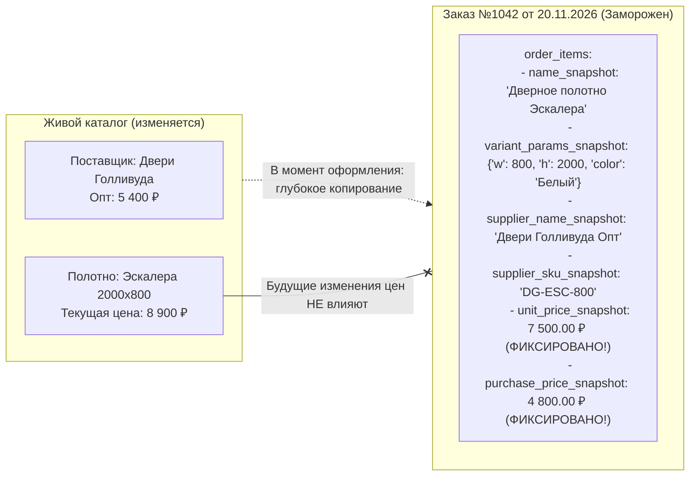

# МОДЕЛЬ ИСТОРИЧЕСКОЙ ФИКСАЦИИ И СНИМКОВ ЗАКАЗА (V3 FINAL)

**Проект:** Федеральный интернет-магазин «Двери №1»  
**Города присутствия:** Казань, Набережные Челны  
**Версия документа:** 3.0 (Финальная спецификация финансовой неизменяемости заказов)  
**Статус:** Утверждено для проектирования чеков, накладных и интеграции с бухгалтерией  

---

## 1. Проблема реляционной зависимости исторических заказов

В типовых архитектурах e-commerce строки заказа часто связываются с таблицей товаров обычным внешним ключом `product_id -> products.id`, а цена берется динамически через `JOIN`.

### Катастрофические последствия такой схемы для дверного магазина:
1. **Переоценка фабрик:** Фабрика «Двереки» раз в полугодие индексирует прайс-лист на 7%. Если цена берется по ссылке, то при обновлении прайса все закрытые заказы клиентов за прошлый год задним числом пересчитаются по новым ценам, разрушая финансовую и бухгалтерскую отчетность.
2. **Удаление/переименование отделок:** Поставщик переименовал цвет «Белый бланко» в «Белый лед». В старых заказах покупатели увидят искаженное название цвета, что спровоцирует судебные споры при рекламациях.
3. **Смена поставщика:** Модель раньше закупалась у дилера «Двери Голливуда» по 5 000 ₽, а теперь закупается напрямую у фабрики по 4 200 ₽. Историческая себестоимость прошлых поставок будет утеряна.

---

## 2. Архитектура полного неизменяемого снимка (Order Immutable Snapshot)

В версии V3 реализована гибридная модель:
1. **Внешние ключи для валидации в момент добавления:**  
   Поля `variant_id`, `molding_id`, `hardware_variant_id`, `supplier_id` имеют внешние ключи `REFERENCES ... ON DELETE RESTRICT`, что гарантирует: в заказ невозможно добавить несуществующий в каталоге артикул.
2. **Полные замороженные снимки в момент сохранения строки:**  
   Все параметры товара копируются в неизменяемые текстовые, числовые и JSONB-поля строки заказа.



---

## 3. Детализация сохраняемых параметров в `order_items`

| Параметр | Поле в таблице `order_items` | Пример сохраняемого значения | Назначение |
| :--- | :--- | :--- | :--- |
| **Тип компонента** | `item_kind` | `'door_leaf'`, `'frame'`, `'casing'`, `'extension'`, `'hinge'`, `'lock'`, `'handle'` | Раздельный учет полотна, погонажа и фурнитуры без смешивания. |
| **Название товара** | `name_snapshot` | `«Дверное полотно Эскалера Белый эмалит»` | Защита от переименования модели маркетологами. |
| **Характеристики** | `variant_params_snapshot` (JSONB) | `{"height_mm": 2000, "width_mm": 800, "color_outside": "Белый эмалит", "direction": "universal", "glass": "Мателюкс белый"}` | Точные параметры проема и геометрии для производства и склада. |
| **Поставщик** | `supplier_name_snapshot` | `«Склад Двери Голливуда Поволжье»` | Фиксация контрагента, у которого фактически заказана партия. |
| **Артикул поставщика** | `supplier_sku_snapshot` | `«DG-ESC-800-WHT»` | Заводской код для выставления рекламации поставщику. |
| **Розничная цена** | `unit_price_snapshot` | `7 500.00` ₽ | Замороженная цена единицы товара для клиента. |
| **Закупочная цена** | `purchase_price_snapshot` | `4 800.00` ₽ | Замороженная оптовая себестоимость (для расчета маржи и прибыли менеджера). |
| **Количество** | `quantity` | `2.50` (для погонажа), `1.00` (для полотна) | Точное нормативное количество с шагом 0.5. |
| **Сумма позиции** | `subtotal` | `18 750.00` ₽ | Вычисляется строго: $ROUND(unit\_price \times quantity, 2)$. |

---

## 4. Фиксация сервисных услуг в `order_services`

Услуги замера, доставки и монтажа вынесены в отдельную таблицу `order_services`, чтобы не искажать товарную себестоимость изделий:

```sql
CREATE TABLE order_services (
    id SERIAL PRIMARY KEY,
    order_id INT NOT NULL REFERENCES orders(id) ON DELETE CASCADE,
    service_type VARCHAR(64) NOT NULL, -- 'measurement', 'delivery_city', 'installation_leaf', 'installation_extension', 'dismantling', 'floor_carry'
    title VARCHAR(255) NOT NULL,       -- «Монтаж межкомнатной двери с добором»
    price_snapshot NUMERIC(10,2) NOT NULL, -- Замороженный тариф услуги
    quantity INT NOT NULL DEFAULT 1,       -- Количество дверей/проемов
    subtotal NUMERIC(10,2) NOT NULL,
    notes TEXT,
    created_at TIMESTAMP WITH TIME ZONE NOT NULL DEFAULT CURRENT_TIMESTAMP,
    CONSTRAINT chk_service_subtotal CHECK (subtotal = ROUND(price_snapshot * quantity, 2))
);
```

---

## 5. Гарантия триггерного пересчета итогов заказа

Триггер `recalc_order_totals()` в ядре базы данных автоматически пересчитывает суммы заказа при добавлении, редактировании или удалении строк:

$$\mathbf{total\_amount} = \sum \mathbf{order\_items.subtotal}$$
$$\mathbf{services\_amount} = \sum \mathbf{order\_services.subtotal}$$
$$\mathbf{grand\_total} = \mathbf{total\_amount} + \mathbf{services\_amount}$$

Никакое округление на уровне интерфейса или опечатка менеджера не могут нарушить математическое равенство итоговой суммы заказа: ограничение `CHECK` гарантирует точность до копейки.
