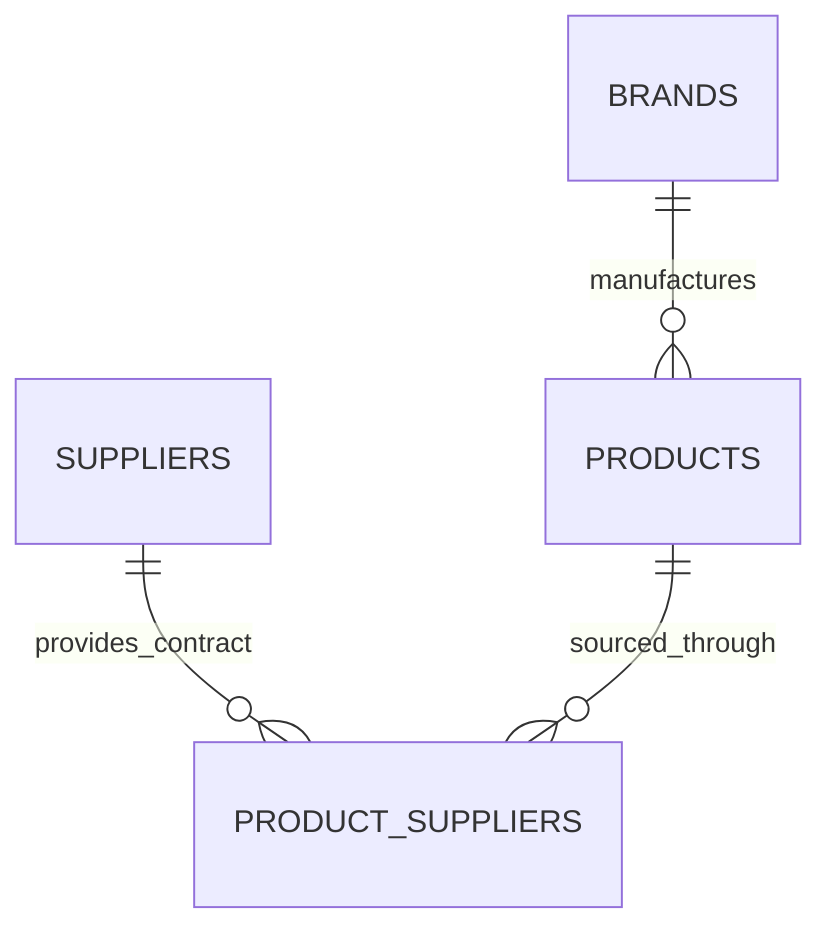

# АРХИТЕКТУРА ПРОИЗВОДИТЕЛЕЙ, ПОСТАВЩИКОВ И МУЛЬТИ-ИСТОЧНИКОВ ПОСТАВКИ (V3 FINAL)

**Проект:** Федеральный интернет-магазин «Двери №1»  
**Города присутствия:** Казань, Набережные Челны  
**Версия документа:** 3.0 (Финальная ревизия нормализации цепочек поставок)  
**Статус:** Утверждено для проектирования каталога и интеграции с поставщиками  

---

## 1. Разделение сущностей «Производители» и «Поставщики»

В версии V2 наблюдалось логическое смешение: поле `supplier_brand_id` ссылалось на таблицу фабрик `brands(id)`. В реальности фабрика-изготовитель (бренд) и коммерческий контрагент-поставщик (дистрибьютор, дилер, оптовая база) — это две принципиально разные сущности с разным жизненным циклом и реквизитами.



### 1.1. Сравнительная характеристика сущностей

| Параметр | Производитель (`brands`) | Поставщик (`suppliers`) |
| :--- | :--- | :--- |
| **Физический смысл** | Завод, фабрика, правообладатель торговой марки | Оптовый дилер, складской оператор, региональный дистрибьютор |
| **Примеры в проекте** | Фабрика «Двереки», «Chameleon Doors», «Феррони», «Morelli» | «Двери Голливуда Опт», «ТК Двери-Опт Поволжье», прямой заводской склад «Двереки-Казань» |
| **Реквизиты** | Бренд, страна, описание, логотип, стилевое позиционирование | Юридическое лицо, ИНН, контакты менеджера, адрес склада отгрузки, договорные условия |
| **Отношение к товару** | Товар жестко принадлежит **одному бренду-изготовителю** ($N : 1$) | Товар может поставляться **несколькими поставщиками** ($M : N$) |

---

## 2. Связь M : N между мастер-карточками и поставщиками

Один производитель может реализовывать продукцию через нескольких независимых поставщиков (например, фабрика «Двереки» отгружает как напрямую, так и через регионального дилера «Двери Голливуда»).  
Один поставщик (например, дилер «Двери Голливуда») поставляет продукцию сразу нескольких брендов («Двереки», «Chameleon», «Luxor»).

### 2.1. Структура сущности `suppliers`

```sql
CREATE TABLE suppliers (
    id VARCHAR(64) PRIMARY KEY,              -- 'dveri_hollywood_opt', 'dvereki_direct', 'ferroni_distr'
    name VARCHAR(255) NOT NULL,              -- Название поставщика для внутренних отчетов
    legal_name VARCHAR(255),                 -- Юридическое лицо: ООО «Двери Голливуда Поволжье»
    inn VARCHAR(12),                         -- ИНН (10 или 12 знаков)
    contact_person VARCHAR(255),             -- Персональный менеджер фабрики/дилера
    phone VARCHAR(50),
    email VARCHAR(255),
    city VARCHAR(100) NOT NULL,              -- Город отгрузочного склада (Казань, Чебоксары, Йошкар-Ола)
    warehouse_address VARCHAR(255),          -- Точный адрес склада самовывоза/отгрузки
    default_lead_time_days INT NULL,         -- Регламентный срок (если строго зафиксирован в договоре)
    is_active BOOLEAN NOT NULL DEFAULT TRUE,
    notes TEXT,
    created_at TIMESTAMP WITH TIME ZONE NOT NULL DEFAULT CURRENT_TIMESTAMP,
    updated_at TIMESTAMP WITH TIME ZONE NOT NULL DEFAULT CURRENT_TIMESTAMP
);
```

### 2.2. Таблица источников поставки `product_suppliers`

Таблица связывает витринную мастер-карточку двери с каждым конкретным поставщиком, фиксируя оптовую стоимость, фабричный артикул и каталог-источник:

```sql
CREATE TABLE product_suppliers (
    id SERIAL PRIMARY KEY,
    product_id VARCHAR(64) NOT NULL REFERENCES products(id) ON DELETE CASCADE,
    supplier_id VARCHAR(64) NOT NULL REFERENCES suppliers(id) ON DELETE RESTRICT,
    supplier_article VARCHAR(100),           -- Артикул в накладных данного поставщика
    catalog_name VARCHAR(255) NOT NULL,      -- Исходный PDF-каталог ('Каталог Двери Голливуда.pdf')
    catalog_page INT NOT NULL,               -- Страница разворота в PDF
    purchase_price NUMERIC(10,2) NULL,       -- Оптовая цена закупки (для маржинального контроля)
    is_primary BOOLEAN NOT NULL DEFAULT FALSE,
    supplier_status VARCHAR(32) NOT NULL DEFAULT 'on_order', -- 'active', 'on_order', 'discontinued'
    lead_time_days INT NULL,                 -- Регламентный срок поставки (дни)
    notes TEXT,
    created_at TIMESTAMP WITH TIME ZONE NOT NULL DEFAULT CURRENT_TIMESTAMP,
    updated_at TIMESTAMP WITH TIME ZONE NOT NULL DEFAULT CURRENT_TIMESTAMP,
    
    CONSTRAINT chk_product_supplier_status CHECK (
        supplier_status IN ('active', 'on_order', 'discontinued')
    ),
    CONSTRAINT uq_product_supplier UNIQUE (product_id, supplier_id)
);
```

---

## 3. Бизнес-правила обработки цепочек поставок

### Правило 1: Отсутствие у Поставщика А не означает отсутствие товара в магазине
При наличии нескольких поставщиков у модели (например, модель «Эскалера», присутствующая в 2 каталогах):
- Если дилер «Двери Голливуда» обнулил складской остаток или вывел модель из матрицы, его статус в связке переводится в `discontinued`.
- Мастер-карточка товара **ОСТАЕТСЯ АКТИВНОЙ** на витрине, так как поставка продолжается через фабрику «Двереки».

### Правило 2: Защита карточки товара от удаления
Никакое автоматическое обновление прайсов поставщиков не имеет права выполнять `DELETE FROM products`. Если товар временно отсутствует у всех поставщиков, его статус переводится в `price_status = 'quote'` или `is_active = FALSE` (скрыт из витринного листинга, но сохраняется в базе для SEO и повторных заказов).

### Правило 3: Заморозка поставщика в заказе (`order_items`)
В момент формирования заказа в таблице `order_items` сохраняются:
- `supplier_id`: внешний ключ на поставщика;
- `supplier_name_snapshot`: текстовое имя поставщика на момент заказа;
- `supplier_sku_snapshot`: фабричный артикул поставщика;
- `purchase_price_snapshot`: оптовая цена закупки.  
Это гарантирует, что даже если через полгода поставщик изменит оптовые цены или расторгнет договор, бухгалтерия интернет-магазина будет видеть точную историческую себестоимость выполненного заказа.

### Правило 4: Запрет выдумывания сроков поставки
Если в договоре с поставщиком не зафиксирован гарантированный срок поставки в рабочих днях:
- Поле `lead_time_days` принимает значение `NULL`.
- На витрине интернет-магазина покупателю выводится статус: **«Под заказ с фабрики (срок уточняется менеджером)»**.  
Фиктивные маркетинговые обещания («3–5 дней») категорически запрещены.
