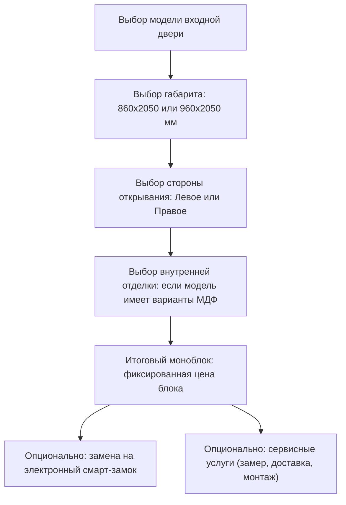
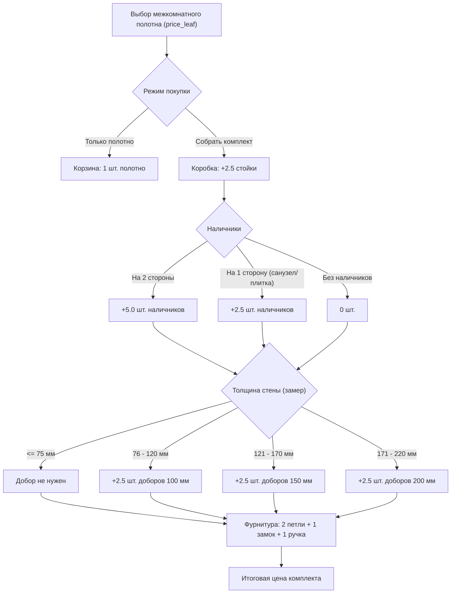
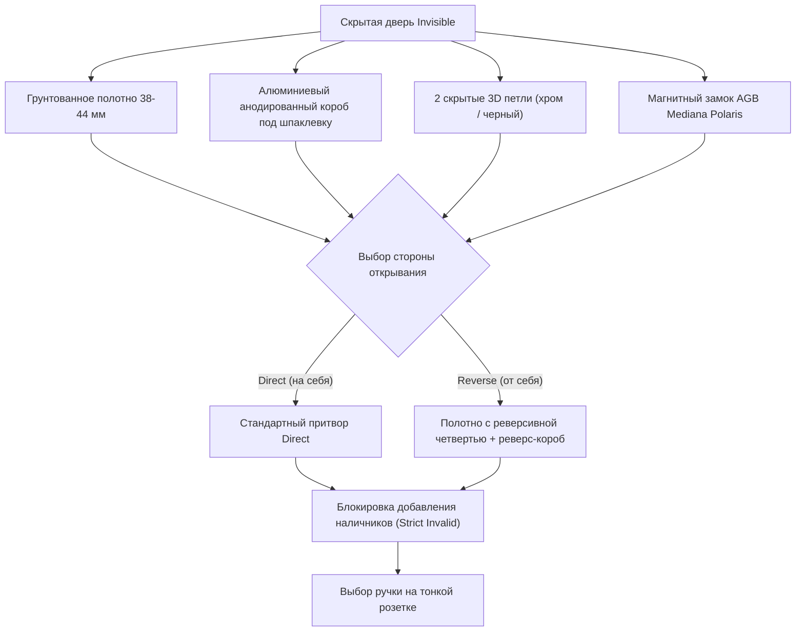

# ЭКСПЕРТИЗА ЛОГИКИ ТРЕХ КОНСТРУКТИВНЫХ МОДЕЛЕЙ КОМПЛЕКТАЦИИ

**Проект:** Интернет-магазин «Двери №1»  
**Дата проведения:** 2026-11-20  
**Объект анализа:** Логика формирования комплекта и расчета цен для `monolithic_block`, `modular_kit` и `invisible_kit`.

---

## 1. Сравнительная матрица типов комплектации

| Параметр | 1. Входные двери (`monolithic_block`) | 2. Межкомнатные двери (`modular_kit`) | 3. Скрытые двери (`invisible_kit`) |
| :--- | :--- | :--- | :--- |
| **Физическая сущность** | Готовый стальной дверной блок заводской сборки | Набор раздельных модулей: полотно + погонаж + фурнитура | Специализированный инженерный комплект скрытого монтажа |
| **Единица продажи** | Дверной блок целиком | Полотно отдельно ИЛИ комплект с погонажем | Комплект фабричной врезки (полотно + короб + скрытые петли + замок) |
| **Полотно** | Интегрировано в блок (сталь + утеплитель + панель) | Продается отдельно (`price_leaf`) | Продается в составе комплекта |
| **Коробка** | Стальной утепленный цельногнутый короб | Телескопический погонаж (2.5 стойки) | Скрытый анодированный алюминиевый короб |
| **Наличники** | Металлический наличник — единое целое с коробом | 2.5 шт. (1 сторона) или 5 шт. (2 стороны) | **КАТЕГОРИЧЕСКИ ЗАПРЕЩЕНЫ** (отделка в плоскость стены) |
| **Доборы** | Не требуются (стандартная глубина 90–148 мм) | 2.5 шт. (рассчитываются по толщине стены $T_{wall} > 75$ мм) | Не требуются (откосы шпаклюются/окрашиваются) |
| **Петли** | 3 шт. наружные на упорных подшипниках (в блоке) | 2–3 шт. накладные бабочки или скрытые | 2–3 шт. скрытые 3D-регулируемые петли (в комплекте) |
| **Замки** | 2 замка (сувальдный + цилиндровый) установлены | Врезной магнитный или механический замок | Врезной магнитный замок с ответной планкой в коробе |
| **Ручки** | Входят в комплект (раздельная ручка) | Приобретаются отдельно (выбор из каталога Morelli/Armadillo) | Приобретаются отдельно (рекомендуются тонкие розетки 3–6 мм) |

---

## 2. Детальная проверка логики моделей

### 2.1. Входные двери — `monolithic_block`



#### Риски и защита от архитектурных ошибок:
- **Риск дублирования стоимости элементов**: Если корзина интернет-магазина будет построена на базе шаблонного универсального модуля e-commerce, система может автоматически предложить покупателю «добавить коробку» или «добавить петли». Для входных дверей это приведет к грубой ошибке в расчете и скандалу с покупателем.
- **Архитектурный инвариант**:
  ```typescript
  if (product.pricing_type === 'monolithic_block') {
      assert(cartItem.molding_items.length === 0, "Коробка и наличники не могут добавляться к моноблоку");
      assert(cartItem.hinges_count === 0, "Петли уже вварены в стальной короб");
      assert(cartItem.price === product.base_kit_price, "Цена моноблока не делится на полотно и короб");
  }
  ```

---

### 2.2. Межкомнатные двери — `modular_kit`



#### Формула динамического расчета стоимости межкомнатного комплекта:
$$P_{total} = P_{leaf} + (2.5 \times P_{frame}) + (K_{casing} \times P_{casing}) + (K_{ext} \times P_{ext}) + (2 \times P_{hinge}) + P_{lock} + P_{handle}$$

Где:
- $K_{casing} \in \{0.0; 2.5; 5.0\}$ — коэффициент количества стоек наличника в зависимости от конфигурации проема;
- $K_{ext} \in \{0.0; 2.5\}$ — необходимость доборного бруса (при толщине стены свыше 75 мм);
- Погонаж кратен **половине стойки (0.5)**, так как на один стандартный проем (высота до 2050 мм, ширина до 900 мм) расходуется ровно 2 вертикальные стойки по 2070 мм и половина стойки на верхнюю горизонтальную перекладину (распил по 1035 мм).

#### Необходимые проверки в интерфейсе конфигуратора:
1. Возможность переключения: **«Только полотно»** vs **«Комплект под ключ»**.
2. Селектор наличников: по умолчанию выбрано **«На 2 стороны (5 шт.)»**, с возможностью переключить на **«На 1 сторону (2.5 шт.)»** или **«Без наличников (0 шт.)»**.
3. Интерактивный ползунок **«Толщина стены в проеме (мм)»**, который автоматически добавляет нужный размер добора (100, 150 или 200 мм) и предупреждает при толщине стены свыше 220 мм о необходимости двойного телескопического стыка.

---

### 2.3. Скрытые двери — `invisible_kit`



#### Риски и защита от архитектурных ошибок:
- **Запрет на наличники**: Короб Invisible монтируется вровень со стеной из гипсокартона или штукатурки. Добавление наличников к скрытой двери физически невозможно. Система обязана программно скрыть вкладку «Наличники» и не допускать их в заказ.
- **Различие Direct и Reverse**:
  - При открывании *Direct (на себя)* дверь распахивается наружу из плоскости стены.
  - При открывании *Reverse (от себя)* полотно имеет заводскую выборку (четверть), а алюминиевый профиль короба имеет форму Z-образного сечения. 
  - Нельзя изменить направление открывания на объекте — оно определяется геометрией заводской фрезеровки и формой алюминиевого короба. Конфигуратор обязан заставлять покупателя явно выбрать: **Direct** или **Reverse**.
