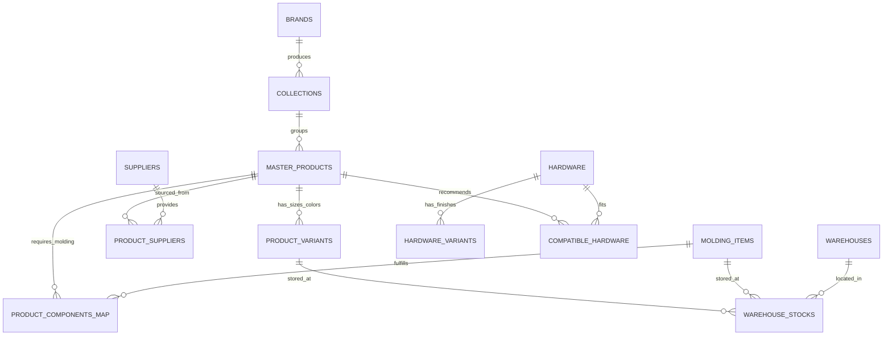

# ТЕХНИЧЕСКАЯ ЭКСПЕРТИЗА СХЕМЫ БАЗЫ ДАННЫХ КАТАЛОГА «ДВЕРИ №1»

**Проект:** Интернет-магазин «Двери №1»  
**Этап:** Экспертиза архитектуры и логики комплектации перед разработкой  
**Дата проведения:** 2026-11-20  
**Статус:** Независимый аудит архитектуры (БЕЗ изменения исходных данных и боевого сайта)

---

## 1. Анализ текущего разделения сущностей

В рамках аудита подготовленных файлов (`data/catalog-audit-v2/` и `data/catalog-output/`) проведена проверка соответствия структуры данных реальным бизнес-процессам интернет-магазина дверей.



### Сверка сущностей и ключевые выводы:

1. **Производители (`brands`) и Коллекции (`collections`)**:
   - Сущности разделены корректно. Связь `1 : N` (один бренд владеет множеством коллекций).
   - Внешний ключ `collections.brand_id -> brands.id` целостен на 100% (94 коллекции привязаны к 15 брендам).
2. **Модели дверей (`products` / `master_products`)**:
   - В текущей структуре зафиксировано 697 дверных позиций.
   - **Упущение текущей схемы**: модель двери сейчас напрямую привязана к одному PDF-каталогу (`source_catalog`). В реальности 24 модели присутствуют одновременно в нескольких каталогах (например, «Эскалера» — и у завода «Двереки», и у дилера «Двери Голливуда»).
   - **Архитектурное требование**: модель должна стать **Мастер-карточкой**, а источники каталогов и поставщики должны быть вынесены в дочернюю таблицу `product_suppliers` (`1 : N`).
3. **Варианты исполнения (`product_variants`)**:
   - Связь `1 : N` (одна модель -> множество вариантов по высоте, ширине, цвету, стороне открывания).
   - Зафиксировано 3 158 вариантов. Связи с родительскими товарами целостны (сиротских записей нет).
4. **Фурнитура (`hardware`)**:
   - 827 позиций фурнитуры полностью изолированы от полотен дверей, что соответствует требованиям ТЗ (ручки, петли, замки, цилиндры, доводчики).
   - **Упущение текущей схемы**: фурнитура сейчас хранится плоским списком, где варианты цветов и артикулов сведены в текстовые поля. Для интернет-магазина каждая отделка ручки (хром, матовый никель, черный) обязана быть отдельным SKU со своим артикулом, штрихкодом и остатком.
5. **Комплектующие и погонаж (`molding_items`)**:
   - **КРИТИЧЕСКАЯ АРХИТЕКТУРНАЯ ОШИБКА текущей схемы `import-schema.md`**: коробки, наличники и доборы описаны в виде текстовых строк внутри таблицы `product_complectation` (например: `"frame_spec": "Телескопический короб МДФ 2070х75х32"`).
   - Текстовое описание делает невозможным:
     - ведение складского учета погонажа по складам Казани и Челнов;
     - автоматическое списание 2.5 стоек коробки и 5 наличников при продаже;
     - раздельный расчет себестоимости и розничной цены погонажа.
   - **Необходимое исправление**: погонажные изделия должны быть полноценной сущностью с артикулом, единицей измерения (штука/комплект), ценой и остатком.

---

## 2. Проверка первичных, внешних ключей и уникальности

| Сущность | Первичный ключ | Внешние ключи | Оценка целостности |
| :--- | :--- | :--- | :--- |
| `brands` | `id` (VARCHAR) | — | 15 уникальных ID. Дубликатов нет. |
| `collections` | `id` (VARCHAR) | `brand_id` -> `brands.id` | 94 уникальных ID. Все ссылки валидны. |
| `products` | `id` (VARCHAR) | `brand_id`, `collection_id` | 697 уникальных ID. 100% валидны. |
| `product_variants` | `id` (VARCHAR) | `product_id` -> `products.id` | 3 158 уникальных ID. 100% валидны. |
| `hardware` | `id` (VARCHAR) | `brand_id` -> `brands.id` | 827 уникальных ID. 100% валидны. |

---

## 3. Критические замечания к текущей схеме данных

### Замечание 1 (Критическое): Отсутствие физической таблицы поставщиков (`product_suppliers`)
- **Проблема**: В `import-schema.md` каталог-источник жестко зашит в карточку товара. При наличии 24 кластеров дублей товар либо дублируется на витрине, либо один из поставщиков теряется.
- **Риск**: Если дилер «Двери Голливуда» уберет модель из складской программы, товар рискует удалиться из каталога магазина, хотя фабрика «Двереки» продолжает его производить.
- **Решение**: Внедрить таблицу `product_suppliers`:
  ```sql
  CREATE TABLE product_suppliers (
      id SERIAL PRIMARY KEY,
      product_id VARCHAR(64) REFERENCES products(id),
      supplier_name VARCHAR(255) NOT NULL,
      supplier_sku VARCHAR(100),
      catalog_name VARCHAR(255) NOT NULL,
      catalog_page INT,
      is_primary BOOLEAN DEFAULT FALSE,
      purchase_price NUMERIC(10,2) NULL,
      lead_time_days INT DEFAULT 14,
      availability_status VARCHAR(64) DEFAULT 'available'
  );
  ```

### Замечание 2 (Критическое): Текстовая комплектация вместо связи с номенклатурой
- **Проблема**: Покупатель покупает межкомнатный комплект: полотно + 2.5 стойки короба + 5 наличников. В текущей схеме нет таблицы связи `product_compatible_moldings`.
- **Решение**: Добавить таблицу `molding_items` и кросс-таблицу совместимости `product_molding_rules`, где для каждой модели жестко зафиксированы совместимые коробки, наличники и доборы того же производителя и покрытия.

### Замечание 3 (Важное): Отсутствие мультискладского учета (Казань / Челны)
- **Проблема**: Магазин работает на два города (Казань, Сибирский тракт, 59б и Набережные Челны, Казанский проспект, 232). В текущей схеме остатки не разделены.
- **Решение**: Таблица `warehouse_stocks` с внешними ключами на товар/погонаж и склад конкретного города.

---

## 4. Рекомендуемая чистовая DDL-схема базы данных

Ниже представлена нормализованная схема, устраняющая все найденные архитектурные дефекты:

```sql
-- 1. Производители
CREATE TABLE brands (
    id VARCHAR(64) PRIMARY KEY,
    name VARCHAR(255) NOT NULL,
    country VARCHAR(100) NOT NULL,
    description TEXT,
    logo_url VARCHAR(500),
    is_active BOOLEAN DEFAULT TRUE,
    created_at TIMESTAMP WITH TIME ZONE DEFAULT CURRENT_TIMESTAMP
);

-- 2. Коллекции
CREATE TABLE collections (
    id VARCHAR(64) PRIMARY KEY,
    brand_id VARCHAR(64) NOT NULL REFERENCES brands(id) ON DELETE RESTRICT,
    name VARCHAR(255) NOT NULL,
    category VARCHAR(100) NOT NULL,
    is_active BOOLEAN DEFAULT TRUE
);

-- 3. Мастер-карточки моделей дверей
CREATE TABLE products (
    id VARCHAR(64) PRIMARY KEY,
    brand_id VARCHAR(64) NOT NULL REFERENCES brands(id) ON DELETE RESTRICT,
    collection_id VARCHAR(64) NOT NULL REFERENCES collections(id) ON DELETE RESTRICT,
    model_name VARCHAR(255) NOT NULL,
    category VARCHAR(100) NOT NULL, -- 'Входные двери', 'Межкомнатные двери', 'Скрытые двери', 'Двери со стеклом'
    door_type VARCHAR(100),
    construction VARCHAR(255),
    coating_type VARCHAR(100),
    style VARCHAR(100),
    has_glass BOOLEAN DEFAULT FALSE,
    glass_type VARCHAR(255),
    pricing_type VARCHAR(32) NOT NULL, -- 'monolithic_block', 'modular_kit', 'invisible_kit'
    base_leaf_price NUMERIC(10,2) NULL, -- Цена только полотна
    base_kit_price NUMERIC(10,2) NULL,  -- Базовая цена комплекта
    price_status VARCHAR(32) DEFAULT 'quote', -- 'quote', 'from', 'fixed'
    is_active BOOLEAN DEFAULT TRUE,
    created_at TIMESTAMP WITH TIME ZONE DEFAULT CURRENT_TIMESTAMP
);

-- 4. Источники поставки для мастер-карточки (решение проблемы 24 кластеров дублей)
CREATE TABLE product_suppliers (
    id SERIAL PRIMARY KEY,
    product_id VARCHAR(64) NOT NULL REFERENCES products(id) ON DELETE CASCADE,
    supplier_brand_id VARCHAR(64) REFERENCES brands(id),
    catalog_pdf VARCHAR(255) NOT NULL,
    catalog_page INT NOT NULL,
    supplier_article VARCHAR(100),
    is_primary_source BOOLEAN DEFAULT FALSE,
    lead_time_days INT DEFAULT 14,
    notes TEXT
);

-- 5. Варианты исполнения моделей дверей (размеры, отделка, открывание)
CREATE TABLE product_variants (
    id VARCHAR(64) PRIMARY KEY,
    product_id VARCHAR(64) NOT NULL REFERENCES products(id) ON DELETE CASCADE,
    height_mm INT NOT NULL,
    width_mm INT NOT NULL,
    thickness_mm INT DEFAULT 38,
    outside_color VARCHAR(255) NOT NULL,
    inside_color VARCHAR(255),
    is_composite_color BOOLEAN DEFAULT FALSE,
    opening_direction VARCHAR(32) DEFAULT 'universal', -- 'universal', 'left', 'right', 'direct', 'reverse'
    image_url VARCHAR(500),
    price_delta NUMERIC(10,2) DEFAULT 0.00,
    is_available BOOLEAN DEFAULT TRUE
);

-- 6. Номенклатура погонажных комплектующих
CREATE TABLE molding_items (
    id VARCHAR(64) PRIMARY KEY,
    brand_id VARCHAR(64) NOT NULL REFERENCES brands(id),
    molding_type VARCHAR(64) NOT NULL, -- 'frame', 'casing', 'extension', 'plinth', 'invisible_frame'
    name VARCHAR(255) NOT NULL,
    coating_type VARCHAR(100),
    color VARCHAR(255) NOT NULL,
    height_mm INT DEFAULT 2070,
    width_mm INT,
    thickness_mm INT,
    unit_price NUMERIC(10,2) NULL,
    price_status VARCHAR(32) DEFAULT 'quote'
);

-- 7. Нормативы комплектации дверей погонажем
CREATE TABLE product_molding_rules (
    id SERIAL PRIMARY KEY,
    product_id VARCHAR(64) NOT NULL REFERENCES products(id) ON DELETE CASCADE,
    molding_item_id VARCHAR(64) NOT NULL REFERENCES molding_items(id) ON DELETE RESTRICT,
    role VARCHAR(32) NOT NULL, -- 'default_frame', 'default_casing', 'compatible_extension'
    default_quantity NUMERIC(4,2) NOT NULL -- 2.5 для коробки, 5.0 для наличников на 2 стороны
);

-- 8. Каталог фурнитуры
CREATE TABLE hardware (
    id VARCHAR(64) PRIMARY KEY,
    brand_id VARCHAR(64) NOT NULL REFERENCES brands(id),
    collection_name VARCHAR(255),
    model_name VARCHAR(255) NOT NULL,
    article VARCHAR(100),
    hardware_type VARCHAR(64) NOT NULL, -- 'handle_rosette', 'handle_plate', 'hinge_concealed', 'hinge_butt', 'lock_magnetic', 'lock_cylinder', 'closer', 'stopper'
    material VARCHAR(100),
    color_finish VARCHAR(255) NOT NULL,
    door_thickness_min INT DEFAULT 35,
    door_thickness_max INT DEFAULT 55,
    base_price NUMERIC(10,2) NULL,
    price_status VARCHAR(32) DEFAULT 'quote',
    image_url VARCHAR(500)
);

-- 9. Склады и учет наличия (Казань и Набережные Челны)
CREATE TABLE warehouses (
    id VARCHAR(32) PRIMARY KEY, -- 'kazan_central', 'chelny_hub'
    city VARCHAR(100) NOT NULL,
    address VARCHAR(255) NOT NULL,
    phone VARCHAR(50)
);

CREATE TABLE stock_items (
    id SERIAL PRIMARY KEY,
    warehouse_id VARCHAR(32) NOT NULL REFERENCES warehouses(id),
    item_type VARCHAR(32) NOT NULL, -- 'door_variant', 'molding', 'hardware'
    item_id VARCHAR(64) NOT NULL,
    stock_status VARCHAR(32) DEFAULT 'on_request', -- 'in_stock', 'out_of_stock', 'on_request'
    quantity INT DEFAULT 0,
    updated_at TIMESTAMP WITH TIME ZONE DEFAULT CURRENT_TIMESTAMP
);

-- 10. Фиксация цен в заказах (Защита истории цен)
CREATE TABLE orders (
    id SERIAL PRIMARY KEY,
    order_number VARCHAR(32) UNIQUE NOT NULL,
    customer_city VARCHAR(64) NOT NULL, -- 'Казань', 'Набережные Челны'
    customer_phone VARCHAR(50) NOT NULL,
    total_amount NUMERIC(10,2) NOT NULL,
    status VARCHAR(32) DEFAULT 'pending_confirmation',
    installation_requested BOOLEAN DEFAULT FALSE,
    created_at TIMESTAMP WITH TIME ZONE DEFAULT CURRENT_TIMESTAMP
);

CREATE TABLE order_items (
    id SERIAL PRIMARY KEY,
    order_id INT NOT NULL REFERENCES orders(id) ON DELETE CASCADE,
    item_type VARCHAR(32) NOT NULL,
    item_id VARCHAR(64) NOT NULL,
    name_snapshot VARCHAR(255) NOT NULL,       -- Замороженное название
    variant_snapshot VARCHAR(255),             -- Замороженный размер и цвет
    price_snapshot NUMERIC(10,2) NOT NULL,      -- Замороженная цена на момент покупки!
    quantity INT NOT NULL,
    subtotal NUMERIC(10,2) NOT NULL
);
```
