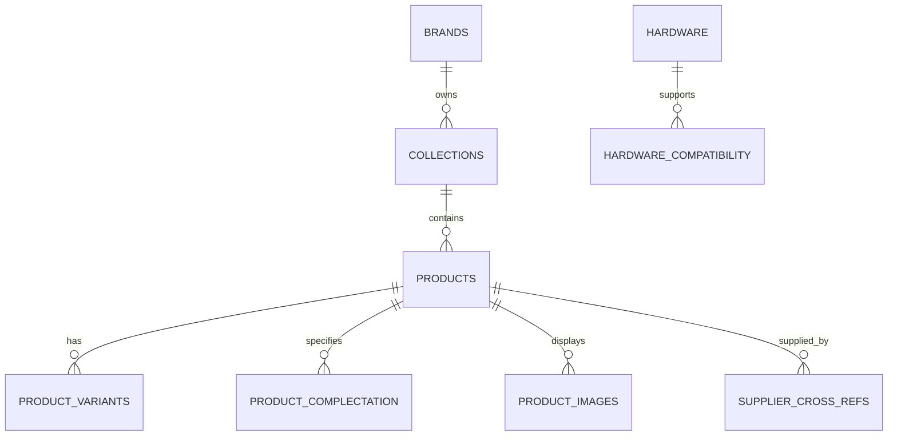

# СХЕМА ДАННЫХ И СТРУКТУРА ИМПОРТА КАТАЛОГА «ДВЕРИ №1»

Данный документ описывает нормализованную реляционную модель базы данных интернет-магазина «Двери №1» (PostgreSQL / Neon).

---

## 1. Таблицы базы данных

### 1. `brands` (Производители)
| Поле | Тип | Описание |
| :--- | :--- | :--- |
| `id` | VARCHAR(64) PK | Уникальный код бренда (`BRAND-FERRONI`, `BRAND-MORELLI`) |
| `name` | VARCHAR(255) NOT NULL | Официальное наименование бренда |
| `country` | VARCHAR(100) | Страна происхождения производства |
| `description` | TEXT | Описание фабрики и технологий |

### 2. `collections` (Коллекции)
| Поле | Тип | Описание |
| :--- | :--- | :--- |
| `id` | VARCHAR(64) PK | Уникальный код коллекции (`COLL-FERR-TERMO`) |
| `brand_id` | VARCHAR(64) FK | Ссылка на `brands.id` |
| `name` | VARCHAR(255) NOT NULL | Наименование коллекции |
| `category` | VARCHAR(100) NOT NULL | Основная товарная категория |

### 3. `products` (Мастер-карточки товаров / Модели)
| Поле | Тип | Описание |
| :--- | :--- | :--- |
| `id` | VARCHAR(64) PK | Внутренний ID (`PROD-FERR-001`) |
| `brand_id` | VARCHAR(64) FK | Ссылка на `brands.id` |
| `collection_id` | VARCHAR(64) FK | Ссылка на `collections.id` |
| `model_name` | VARCHAR(255) NOT NULL | Название модели двери |
| `category` | VARCHAR(100) NOT NULL | Входные / Межкомнатные / Скрытые / Со стеклом |
| `door_type` | VARCHAR(100) | Конструктивный тип |
| `construction` | VARCHAR(255) | Царговая / каркасно-щитовая / цельногнутая сталь |
| `primary_material`| VARCHAR(255) | Сталь, МДФ, массив сосны, алюминий |
| `coating` | VARCHAR(255) | Эмаль, ПВХ, полипропилен, порошковое напыление |
| `style` | VARCHAR(100) | Современный, классика, неоклассика, лофт, хай-тек |
| `has_glass` | BOOLEAN DEFAULT FALSE | Флаг наличия остекления |
| `pricing_type` | VARCHAR(32) NOT NULL | `monolithic_block` (входная) или `modular_kit` (межкомнатная) |
| `price_leaf` | NUMERIC(10,2) NULL | Базовая розничная цена полотна |
| `price_kit_base` | NUMERIC(10,2) NULL | Базовая розничная цена полного комплекта |
| `price_status` | VARCHAR(32) DEFAULT 'quote' | `quote` (уточняется), `from` (от), `fixed` (фиксированная) |

### 4. `product_variants` (Варианты исполнения)
| Поле | Тип | Описание |
| :--- | :--- | :--- |
| `id` | VARCHAR(64) PK | Внутренний ID варианта (`VAR-PROD-FERR-001-1`) |
| `product_id` | VARCHAR(64) FK | Ссылка на `products.id` |
| `height_mm` | INT NOT NULL | Высота полотна (2000 мм, 2050 мм) |
| `width_mm` | INT NOT NULL | Ширина полотна (600, 700, 800, 900 мм) |
| `outside_color` | VARCHAR(255) | Цвет внешней стороны |
| `inside_color` | VARCHAR(255) | Цвет внутренней стороны |
| `opening` | VARCHAR(32) | `universal`, `left`, `right`, `direct`, `reverse` |
| `price_override`| NUMERIC(10,2) NULL | Индивидуальная наценка за размер/отделку |

### 5. `product_complectation` (Нормативы комплектации)
| Поле | Тип | Описание |
| :--- | :--- | :--- |
| `id` | SERIAL PK | Первичный ключ |
| `product_id` | VARCHAR(64) FK | Ссылка на `products.id` |
| `frame_spec` | VARCHAR(255) | Описание коробки (телескоп 75х32, алюминий Invisible) |
| `casing_spec` | VARCHAR(255) | Описание наличников (плоские телескоп, фигурные) |
| `extension_spec`| VARCHAR(255) | Рекомендуемые доборы (100/150/200 мм) |
| `hinges_spec` | VARCHAR(255) | Тип и число петель (2 скрытые, 3 наружные) |
| `locks_spec` | VARCHAR(255) | Тип замка (магнитный сантехнический, сувальдный) |
| `is_frame_included` | BOOLEAN | Входит ли короб в цену базового полотна |

### 6. `hardware` (Фурнитура)
| Поле | Тип | Описание |
| :--- | :--- | :--- |
| `id` | VARCHAR(64) PK | Уникальный ID (`HDW-ARM-001`) |
| `brand_id` | VARCHAR(64) FK | Ссылка на `brands.id` |
| `model_name` | VARCHAR(255) NOT NULL | Модель ручки / замка / петли |
| `article` | VARCHAR(64) | Фабричный артикул поставщика |
| `hardware_type`| VARCHAR(100) NOT NULL | `handle_rosette`, `hinge_concealed`, `lock_magnetic` |
| `material` | VARCHAR(100) | ЦАМ (ZAMAK), латунь, сталь |
| `color_finish` | VARCHAR(255) | Хром, черный, золото, матовый никель |
| `door_thickness_min` | INT DEFAULT 35 | Мин. толщина совместимой двери (мм) |
| `door_thickness_max` | INT DEFAULT 55 | Макс. толщина совместимой двери (мм) |

---

## 2. Разделение сущностей цены (Пункт 5 задания)

В интернет-магазине строго разграничены две сущности цены:
1. **`price_leaf` (Цена полотна)**:
   - Применяется для межкомнатных дверей.
   - Покупатель может приобрести только полотно для замены в существующий проем или раздвижную перегородку.
2. **`price_kit_base` (Цена полного комплекта)**:
   - Рассчитывается динамически: `Цена полотна + (2.5 шт. коробки) + (5 шт. наличников) + петли + замок`.
   - Для входных дверей цена полотна и цена комплекта совпадают, так как входная стальная дверь поставляется единым готовым монолитным блоком.
